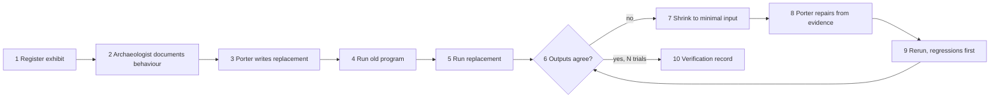
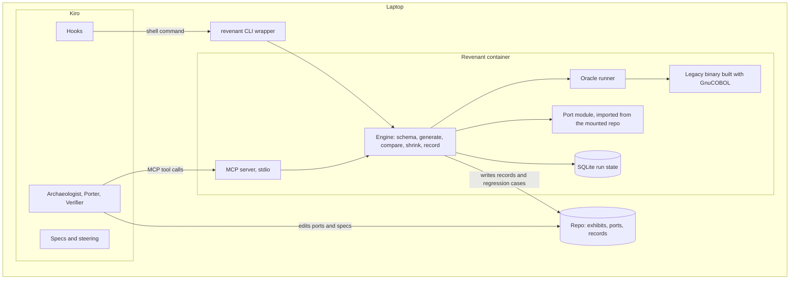
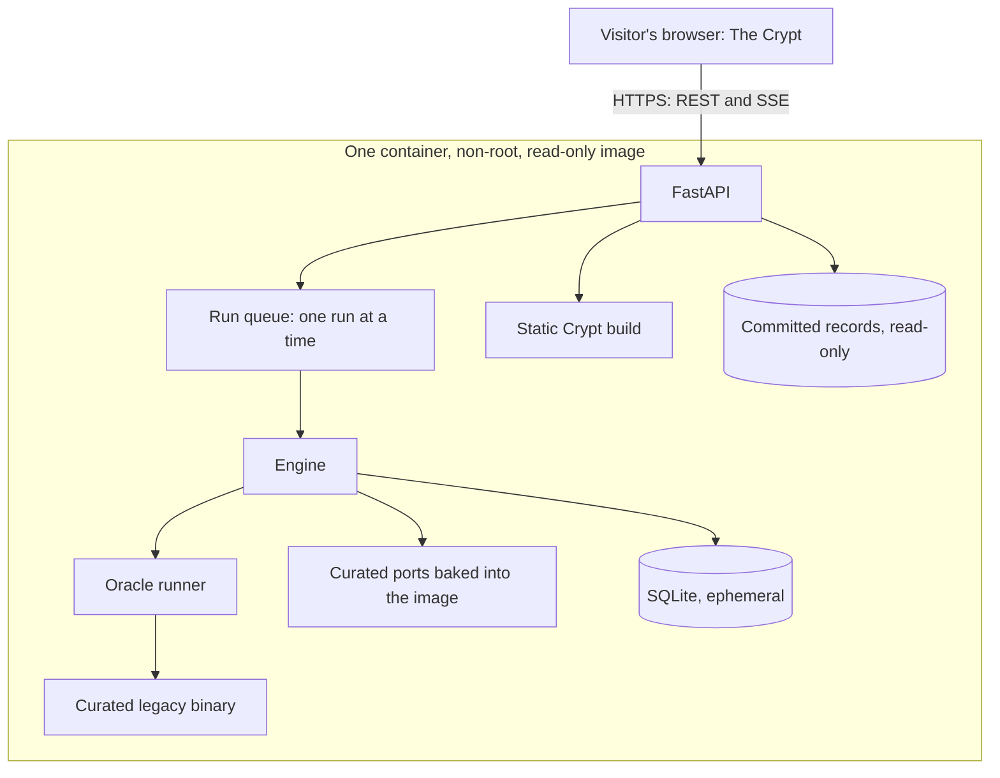
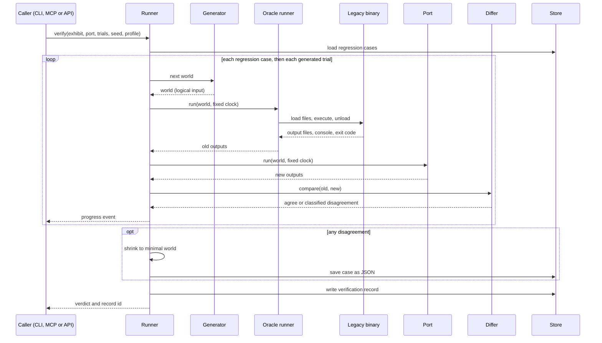
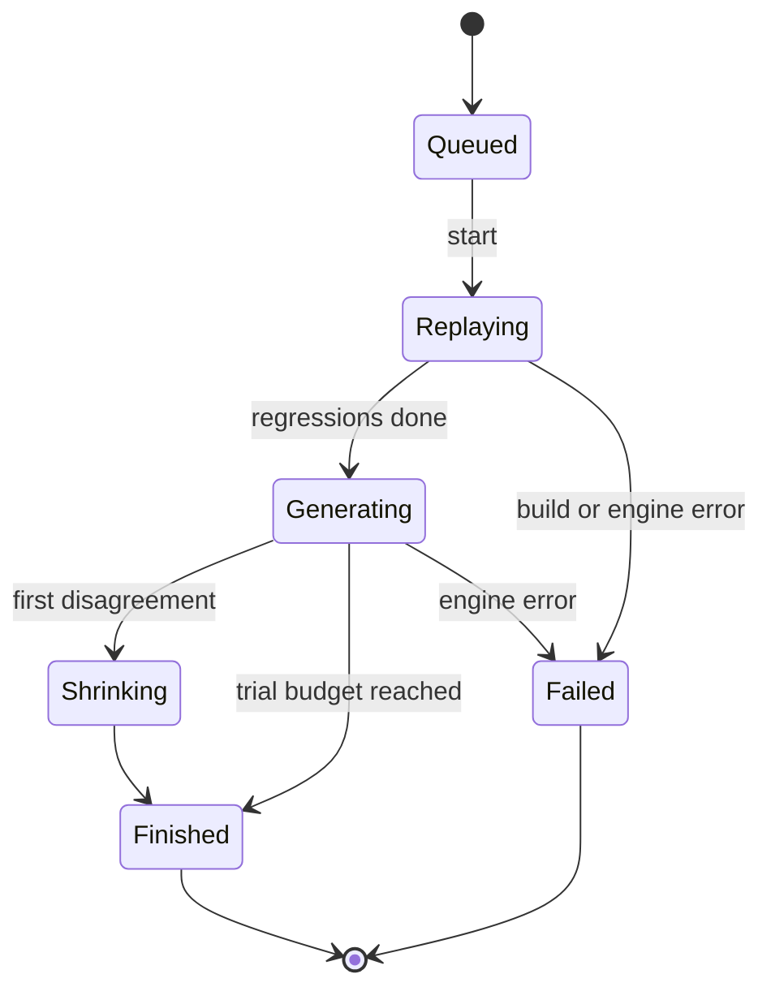
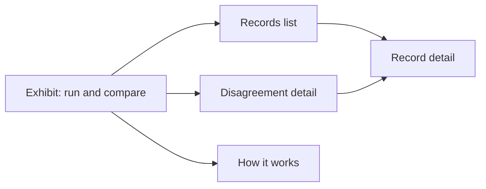

# Revenant — Product Requirements & Technical Design

Nov 14, 2026 · @Ben

## Contents

1. Project overview
2. The core product experience
3. Product scope and requirements
4. Detailed technical architecture
5. Differential testing engine
6. Kiro-native development workflow
7. User interface and UX design
8. Data models, APIs and repository structure
9. Demo application and technical proof
10. Testing, security and reliability
11. Development roadmap
12. Risks, unknowns and decisions
13. Hackathon submission strategy
14. Final project blueprint

## 1. Project overview

Revenant checks a modern replacement for an old program by running both on the same generated inputs and reporting the smallest input where they disagree. It is a verification tool. Translation is left to Kiro.

| Item | Definition |
| --- | --- |
| Name | Revenant |
| Tagline | The old program gets the last word |
| Elevator pitch | Keep a legacy program running as a witness. Generate thousands of valid inputs from its own data definitions, run old and new side by side, and hand Kiro the smallest input on which they differ |
| Category | Kiroween 2026, Resurrection |
| Form | An engine with three faces: a command-line tool, an MCP server for Kiro, and a public page called The Crypt |
| First exhibit | `CBACT04C`, the interest-calculation batch program from AWS's open-source CardDemo sample, built unmodified with GnuCOBOL and checked against a Python port |

### Executive summary

AI agents can rewrite an old program in minutes. Nobody can tell from reading the result whether it computes the same thing. Tests written by the same agent that wrote the port share its misunderstandings, so they pass.

Revenant treats the original program as an independent behavioural reference, an oracle. It builds the original, feeds it generated inputs, feeds the same logical inputs to the replacement, and compares outputs field by field. When they differ, it reduces the input to a minimal counterexample and gives that evidence to Kiro. When they agree across a run, it writes a reproducible verification record stating what was tested and within what bounds.

A feasibility spike for this document built the unmodified CardDemo program and ran it against Python ports. A careful port agreed on 1,000 generated trials. Two naive ports were caught, and each failure shrank to a single account. Section 9 gives the details.

### Problem statement

A developer inherits a batch program whose author has left. The program is the only complete statement of the rules it enforces. Any rewrite risks silent changes in rounding, truncation, record layout or edge-case handling. Enterprise modernisation services check this with captured production data on a mainframe. A developer with one program, a laptop and an AI coding agent has nothing equivalent.

### Audience and use cases

| Audience | Use case |
| --- | --- |
| A developer replacing one legacy batch program | Check an AI-assisted port before retiring the original |
| A small IT team without a modernisation contract | Produce evidence for a reviewer that the replacement matches |
| Kiro users doing spec-driven ports | Give the agent concrete failing inputs instead of asking it to review its own work |
| Hackathon judges and visitors | Press Run on a public page and watch a real disagreement appear |

### Explained without jargon

Imagine replacing an old calculator with a new one. You could read both manuals and hope. Or you could type the same thousands of sums into both and look for any answer that differs. Revenant does the second thing for software. When it finds a difference, it finds the simplest sum that shows it. When it finds none, it tells you exactly how many sums it tried and of what kind. It never says the two are identical, because nobody tried every sum.

### Explained for engineers

Revenant is a differential, property-based testing harness with a legacy executable as the test oracle. A small parser turns COBOL data declarations into field schemas. Those schemas drive record codecs and input strategies. A hand-written world model per exhibit supplies cross-file constraints. Each trial materialises one generated world as the legacy program's physical files, executes the legacy binary in a sandboxed subprocess, executes the port on the same logical world, decodes both outputs, and compares them at raw-byte and parsed-field level. Failures are shrunk by the testing library and persisted as explicit inputs. A run produces a verification record containing versions, hashes, seed, bounds, counts and counterexamples. The same engine is exposed over MCP so a Kiro agent can call the oracle and the differ as tools.

### Value proposition and what makes it interesting

- **Independent evidence.** The check does not depend on the agent that wrote the port.
- **Minimal counterexamples.** A failing run yields one small, replayable input per kind of disagreement.
- **Honest claims.** A passing run is reported as agreement on N generated trials within stated bounds. Generated testing gives evidence of behavioural agreement. It is not a proof of equivalence.
- **Bug-compatibility is visible.** The old program's quirks surface as findings a human must rule on. The spike found one in the first hour.
- **Native to Kiro.** The oracle is an MCP tool, and three agents with separate permissions keep the porter from grading itself.

### What the finished application accomplishes

1. Builds and runs one curated legacy program deterministically in a container.
2. Generates valid inputs, runs old and new, and detects, classifies and shrinks disagreements.
3. Lets a Kiro agent drive that loop through MCP.
4. Shows the loop to anyone in a browser, on curated examples only.
5. Writes a verification record another person can reproduce from a clean checkout.

## 2. The core product experience

A developer works in Kiro, where agents read the old code and write the port. Revenant does the running, comparing and recording, and it never edits code. The loop repeats until a run finishes with no unresolved disagreement.



### Who does what at each step

| Step | User action | Revenant action | Kiro involvement | Runs in | Approval |
| --- | --- | --- | --- | --- | --- |
| 1. Register the legacy program | Adds source, copybooks and an exhibit config; runs `revenant build` | Compiles with GnuCOBOL in the container; stores compiler version and binary hash | Optional: Kiro scaffolds the config | Revenant CLI | None |
| 2. Analyse the legacy program | Asks the Archaeologist to document behaviour | Serves `describe_io`; executes probe inputs through `run_legacy` | Archaeologist reads source, probes the oracle, writes requirements and assumptions | Kiro, calling Revenant over MCP | User approves the requirements |
| 3. Create the replacement | Approves design and tasks | None, apart from a quick check fired by a hook | Porter implements the port from the approved spec | Kiro | User approves spec phases and file writes |
| 4. Run the original | Starts a run from the CLI, the Verifier agent or The Crypt | Generates inputs, writes the old program's files, executes the binary | Verifier calls `run_differential` | Revenant engine | None |
| 5. Run the replacement | None | Calls the port with the same logical input and the same fixed clock | None | Revenant engine | None |
| 6. Compare | None | Decodes both outputs; compares bytes and fields; classifies differences | None | Revenant engine | None |
| 7. Minimise | None | Shrinks each kind of failure to a minimal input; saves it as a regression case | None | Revenant engine | None |
| 8. Investigate and repair | Reviews the evidence and the proposed fix | Serves `latest_disagreement` and `replay_case` | Porter reads the counterexample and edits the port. Verifier cannot edit | Kiro | User approves the code change, and rules on whether a quirk is preserved |
| 9. Verify again | None, or reruns manually | Replays saved regressions first, then fresh trials | Hook reruns a short check after each agent edit | Revenant engine | None |
| 10. Produce the record | Commits the port | Writes the record; CI regenerates it from a clean checkout | Verifier summarises the record in chat | Revenant engine and CI | User decides to publish |

### Inputs, outputs, errors and what the user sees

| Step | Inputs | Outputs | Possible errors | Experience |
| --- | --- | --- | --- | --- |
| 1 | Source, copybooks, exhibit config | Binary, build report | Compile error; unsupported file organisation; unsupported data clause | One command. A clear message naming the clause that is not supported |
| 2 | Source, schemas, probe inputs | Requirements in EARS form; list of assumptions and open questions | Agent misreads code; probe input rejected as out of bounds | A requirements file where each statement cites a paragraph of the old program or an oracle observation |
| 3 | Approved spec, steering rules | Port module with a fixed entry point | Port does not import; wrong entry-point signature | Normal Kiro task flow |
| 4 | Seed, trial count, profile | Old outputs per trial | Non-zero exit, timeout, missing output file | A live counter; oracle errors are counted separately and never treated as agreement |
| 5 | The same logical input | New outputs per trial | Exception, timeout | Exceptions become disagreements of kind `error` |
| 6 | Both outputs, normalisation rules | Agree, or a classified disagreement | Decoder cannot parse a record | Field-level diff with raw bytes available |
| 7 | A failing input | Minimal failing input, stored as JSON | Shrinking budget exhausted | "Shrinking" phase visible; result is still valid if the budget runs out, only less small |
| 8 | Counterexample, diff, spec | Code change | Fix breaks another case | The agent quotes the failing input in its explanation |
| 9 | Regression cases, new seed | New run result | Old counterexample fails again | Regressions listed by name, pass or fail |
| 10 | Run result, environment facts | Verification record in JSON and a readable page | Dirty working tree | Record flagged "not reproducible" unless produced from a clean commit |

### What happens where

| Inside Kiro | Inside Revenant |
| --- | --- |
| Reading and explaining the old source | Building and executing the old program |
| Writing requirements, design and tasks | Generating inputs and encoding records |
| Writing and repairing the port | Executing the port, comparing, classifying, shrinking |
| Deciding, with the user, whether a quirk is preserved | Storing counterexamples and writing records |
| Calling Revenant's tools | Serving The Crypt |

### Automated versus approved

- **Automated:** build, input generation, execution of both sides, comparison, shrinking, regression replay, record writing, the post-edit quick check.
- **Needs the user:** approving requirements, design and tasks; approving code changes to the port; ruling on each finding where the old program's behaviour looks like a bug; publishing a record.
- **Never done by Revenant:** editing the port, editing the old program, or deciding that a disagreement is acceptable.

## 3. Product scope and requirements

The MVP is one legacy program, one Python port, one engine, one MCP server and one public page. Everything below is sized for a solo developer with about 70 focused hours between November 14 and December 4, 2026, on an Apple Silicon MacBook Pro, building with Kiro.

Priority: **M** must ship, **S** should ship if milestones hold, **C** could ship as a stretch.

### A. Legacy program oracle

The oracle runs the old program exactly as built, once per trial, in a throwaway directory. The legacy source is never edited. Two kinds of helper stand in for the mainframe environment: a ten-line driver that passes the run-date parameter the way the job control did, and small load and unload utilities that copy fixed-width text records into and out of the indexed files the program expects.

| ID | Requirement | Priority |
| --- | --- | --- |
| O-1 | Build the unmodified `CBACT04C.cbl` and its copybooks with GnuCOBOL inside a pinned container image; record compiler version and binary SHA-256 | M |
| O-2 | Accept one logical input (a "world": run date plus rows for four input files) and materialise it as the program's physical files | M |
| O-3 | Execute with a sanitised environment, a fixed clock, a wall-clock timeout and resource limits | M |
| O-4 | Capture the output transaction file, the account file after the run, console output and exit code | M |
| O-5 | Return outputs both as raw bytes and as decoded fields | M |
| O-6 | Be deterministic: the same world gives byte-identical output after declared normalisation, on repeated runs | M |
| O-7 | Record which paragraphs of the old program executed, using the compiler's trace option | S |
| O-8 | Support a second exhibit behind the same interface | C |

### B. Automated differential testing

| ID | Requirement | Priority |
| --- | --- | --- |
| D-1 | Derive field schemas (offset, length, kind, sign, scale) from COBOL data declarations for the clauses the exhibit uses; fail closed on anything else | M |
| D-2 | Generate structured inputs from those schemas plus an exhibit-specific world model that enforces cross-file constraints | M |
| D-3 | State input boundaries explicitly as a named profile, and store the profile in every record | M |
| D-4 | Represent money and rates as integers of the smallest unit end to end; no floats anywhere in the engine | M |
| D-5 | Run old and new on the same logical input with the same injected clock | M |
| D-6 | Compare raw bytes and parsed fields; apply only declared normalisations; classify each difference | M |
| D-7 | Shrink each kind of failure to a minimal input and persist it as an explicit JSON case | M |
| D-8 | Take a seed; store it; replay saved cases before generating new ones | M |
| D-9 | Count oracle errors and timeouts separately; a run with any is not reported as agreement | M |
| D-10 | Produce a human-readable report and a machine-readable record per run | M |
| D-11 | Let a human register an accepted divergence with a written justification | S |
| D-12 | A wider "extended" profile covering overflow and negative rates | C |

### C. Kiro integration

| ID | Requirement | Priority |
| --- | --- | --- |
| K-1 | MCP server exposing build, run, describe, verify, latest-disagreement, replay and record tools | M |
| K-2 | Steering files for product, tech, structure and COBOL semantics | M |
| K-3 | Three custom agents with distinct tool and path permissions | M |
| K-4 | Hooks that run a short verification after an agent edits the port and log each session | M |
| K-5 | Specs for every engine component, with correctness properties checked by Kiro's property-based tests in the IDE | M |
| K-6 | A Kiro power that installs the MCP server and a workflow skill | S |
| K-7 | A Kiro Crew job that reruns verification nightly | C |

### D. The Crypt

| ID | Requirement | Priority |
| --- | --- | --- |
| C-1 | Show the old program and the port side by side for the same input | M |
| C-2 | Start a run on a curated exhibit and port, with a chosen trial count and seed | M |
| C-3 | Stream progress: trials done, agreements, disagreements, phase | M |
| C-4 | Show each disagreement with its minimal input, field-level diff, classification and reproduction command | M |
| C-5 | List verification records and show one in full, with JSON download | M |
| C-6 | Accept no code and no files from visitors; all inputs are validated values within the profile | M |
| C-7 | A form to try one hand-entered input on both sides | S |
| C-8 | Paragraph-coverage view of the old program | C |

### E. Verification records

| ID | Requirement | Priority |
| --- | --- | --- |
| R-1 | Identify both programs: source hashes, binary hash, port commit, compiler and interpreter versions | M |
| R-2 | Identify the engine: version, testing-library version, container image digest, platform | M |
| R-3 | State the seed, trial count, profile and its numeric bounds, and normalisations applied | M |
| R-4 | List disagreements with kind, minimal input and both outputs; list accepted divergences and findings | M |
| R-5 | Report timing, oracle errors, timeouts and shrink steps | M |
| R-6 | State what was not compared | M |
| R-7 | Carry a verdict from a fixed vocabulary and a one-line claim in plain words | M |
| R-8 | Be regenerable by one documented command from a clean checkout | M |

### Non-functional targets

| Area | Target | Basis |
| --- | --- | --- |
| Throughput | At least 30 trials per second on one core | The spike measured 22 to 26 ms per trial, including six process launches |
| Public run | 1,000 trials finish in under 60 seconds | Same measurement, with headroom for a small host |
| Determinism | 100 repeated executions of one input give identical normalised output | Acceptance test |
| Honesty | No screen or record uses "proven", "verified equivalent" or a percentage of confidence | Copy review |

### Explicitly out of scope

- Any translation engine or model call inside Revenant.
- A second source language, a general COBOL parser, screens, databases, message queues and job control.
- Packed or binary numeric fields, repeating groups and redefinitions, unless the exhibit needs them.
- Uploads of code or files to the public site, user accounts and multi-tenant storage.
- Performance comparison of old and new.

## 4. Detailed technical architecture

Revenant is one Python package with three entry points (CLI, MCP server, web API) and one container image that holds the COBOL toolchain. The same image runs on the developer's laptop and on the public host, so the old program behaves identically in both places.

### Stack decisions

| Component | Proposed | Decision | Reason |
| --- | --- | --- | --- |
| Frontend | React, TypeScript, Vite | Keep; add Tailwind CSS and Radix primitives | Fast to style; accessible dialogs and tabs without writing them |
| Backend | Python, FastAPI | Keep; progress over Server-Sent Events | One-way stream is all the page needs; no WebSocket state |
| Legacy runtime | GnuCOBOL | Keep, pinned to the 3.x package with indexed-file support | The spike found Ubuntu's `gnucobol4` package is built without indexed files and cannot compile the exhibit; `gnucobol3` (3.1.2) can |
| Differential testing | A Python property-based framework | Hypothesis | Mature shrinking, explicit seeds, the library Python developers already know |
| MCP integration | Python MCP SDK | Keep; stdio transport | Kiro launches local servers by command |
| Storage | SQLite and JSON | Keep; SQLite for run state, JSON files for records | Records must be diffable and committed to git |
| Deployment | Docker | Keep; one image for local and hosted | Removes the Apple Silicon toolchain question |
| AI reasoning | Kiro and its models | Keep; no model calls in Revenant | The product stays deterministic and free to run |

The one structural adjustment: the engine always runs inside the container, including during local development. Kiro and the CLI reach it through a thin wrapper script. This avoids maintaining a native macOS COBOL toolchain.

### Local developer workflow



### Hosted public demonstration



The hosted container has no MCP server, no Kiro, no write access to exhibits or ports, and no way to receive code. Visitors choose among curated ports and supply only numbers.

### Component responsibilities

| Component | Responsibility | Does not |
| --- | --- | --- |
| Copybook parser | Turn data declarations into field schemas | Parse procedure code |
| Codec | Encode logical records to fixed-width bytes and decode them back | Guess encodings; unsupported clauses raise |
| World model (per exhibit) | Generate consistent sets of rows across files; map them to physical files | Live in the engine core |
| Oracle runner | Create a trial directory, load files, execute the binary, unload results, enforce limits | Interpret results |
| Port adapter | Call the port's entry point with the same world and clock | Format the port's output for it |
| Differ | Compare, normalise, classify | Decide acceptability |
| Runner | Drive Hypothesis, replay regressions, emit progress events | Hold state across runs |
| Recorder | Assemble and write the verification record | Edit past records |
| MCP server | Expose engine functions as tools | Add logic of its own |
| API | Serve The Crypt, queue runs, stream events | Run arbitrary exhibits |

### One verification run



### Run lifecycle



`Finished` carries one of four verdicts: `AGREED`, `DISAGREED`, `AGREED_WITH_ACCEPTED_DIVERGENCE` or `INCONCLUSIVE`. `INCONCLUSIVE` means oracle errors or timeouts occurred, so the run cannot support a claim either way.

### Isolation and security boundaries

| Concern | Local development (trusted) | Hosted demo (untrusted visitors) |
| --- | --- | --- |
| Whose code runs | Yours: any exhibit and port in the repo | Only exhibits and ports baked into the image at build time |
| What a caller can supply | Anything | Exhibit id, port id, trial count up to 1,000, seed, and field values validated against the schema and profile |
| Process isolation | Container; per-trial temp directory | Same, plus non-root user, read-only root filesystem, temp space on tmpfs |
| Subprocess limits | 5 s wall clock per trial | 2 s wall clock, CPU and memory limits, output-size limit |
| Concurrency | Unrestricted | One run at a time, short queue, per-address rate limit |
| Network | Not needed by the engine | No outbound calls made; block egress where the host allows |
| Command construction | Argument lists and explicit environment maps; never a shell string | Same |

### Error handling, logging and persistence

| Error class | Raised when | Surfaced as |
| --- | --- | --- |
| `BuildError` | Compiler fails or indexed files are unsupported | CLI exit 2; MCP error result; API 500 with detail |
| `OracleError` | Non-zero exit, timeout, missing or malformed output | Counted per run; verdict becomes `INCONCLUSIVE` |
| `PortError` | Port raises or times out | A disagreement of kind `error` or `timeout` |
| `DecodeError` | Output bytes do not fit the schema | A disagreement of kind `structure`, with raw bytes kept |
| `ProfileError` | A supplied input is outside the profile | API 422; MCP error result |

- **Logging.** JSON lines with run id, trial index, phase and duration. The hosted service logs case ids, not input values. Locally, `--keep` retains trial directories for inspection.
- **Persistence.** SQLite holds runs and disagreements for the current deployment. Records and regression cases are JSON files in the repo. The hosted database is ephemeral by design; committed records ship read-only in the image.

### Deployment

A multi-stage Dockerfile builds the Crypt to static files, then assembles an Ubuntu 24.04 image with `gnucobol3`, Python, the engine, and legacy binaries compiled at build time. FastAPI serves the static files and the API on one port. Any container host with about 1 GB of memory is enough. There is no database server, cache, queue or object store.

## 5. Differential testing engine

The engine turns data declarations into generators, runs both programs on each generated input, compares at two levels, and shrinks failures. Statements marked **confirmed** were observed in the spike on GnuCOBOL 3.1.2, Ubuntu 24.04, x86-64, with Hypothesis 6.170. Code samples are design sketches, not tested implementations.

### Input generation

The copybook parser reads only data declarations. Each elementary item becomes a field with an offset, a length and a kind.

| Declaration | Logical value | Physical bytes | Generator |
| --- | --- | --- | --- |
| `PIC X(n)` | String | Left-justified, space-padded to n | Text from a declared alphabet, length 0 to n |
| `PIC 9(n)` | Non-negative integer | n digits, zero-padded | Integers 0 to 10^n - 1, narrowed by the profile |
| `PIC S9(n)V9(m)` | Signed integer count of the smallest unit | n+m digits, no stored decimal point, sign carried in the last digit | Integers within the profile's bounds |
| `FILLER` | Not generated | Constant fill | None; excluded from field compare, included in byte compare |
| Group item | Nested record | Concatenation of children | Composition |
| `COMP`, `COMP-3`, `OCCURS`, `REDEFINES` | Unsupported in the MVP | n/a | Parser raises with the item name |

Money and rates never become floats. `S9(09)V99` holding 100.50 is the integer 10050 everywhere in the engine.

```python
@dataclass(frozen=True)
class Field:
    name: str
    offset: int
    length: int
    kind: Literal["alnum", "uint", "sdec", "filler"]
    scale: int = 0          # digits after the implied decimal point

PIC = re.compile(r"PIC\s+(S)?(X|9)\((\d+)\)(?:V9+\((\d+)\)|V(9+))?", re.I)

def field_from_pic(name: str, pic: str, offset: int) -> Field:
    m = PIC.search(pic)
    if not m:
        raise UnsupportedClause(name, pic)       # fail closed
    signed, base, n, m1, m2 = m.groups()
    scale = int(m1) if m1 else len(m2 or "")
    length = int(n) + scale
    if name.upper() == "FILLER":
        return Field(name, offset, length, "filler")
    if base.upper() == "X":
        return Field(name, offset, length, "alnum")
    return Field(name, offset, length, "sdec" if signed else "uint", scale)
```

**Sign encoding is a trap, confirmed.** As built in the spike, GnuCOBOL stores a negative display number by replacing the last digit with a letter from `p` to `y`. CardDemo's sample data uses the mainframe convention instead, where `{` marks a positive zero and `}` a negative zero. The program read `{` correctly as zero, but read a mainframe-style negative as positive without any error. The encoder must therefore emit the runtime's own convention, and a round-trip test through the real program must guard it.

```python
def encode_sdec(value: int, length: int) -> bytes:
    digits = str(abs(value)).rjust(length, "0")
    if len(digits) > length:
        raise ProfileError("value exceeds field width")
    if value < 0:
        digits = digits[:-1] + chr(ord("p") + int(digits[-1]))
    return digits.encode("ascii")

def decode_sdec(raw: bytes) -> int:
    s = raw.decode("ascii")
    last = s[-1]
    if "p" <= last <= "y":
        return -int(s[:-1] + str(ord(last) - ord("p")))
    if last == "{":                      # mainframe-style positive zero in seed data
        return int(s[:-1] + "0")
    return int(s)
```

**Field schemas are not enough.** The exhibit reads four related files. A balance row must point at an existing account, and a rate is looked up by the account's group. The schema cannot express that, so each exhibit carries a short hand-written world model. The spike's first reported disagreement was a mistake in this model, not in the port: it generated rates per account when the program stores them per group. World models need review like any other test code.

```python
@st.composite
def worlds(draw, p: Profile):
    n = draw(st.integers(1, p.max_accounts))
    groups = draw(st.lists(group_ids, min_size=1, max_size=2, unique=True))
    accounts = [
        Account(id=i + 1,
                group=draw(st.sampled_from(groups)),
                balance=draw(money(p.max_balance)))
        for i in range(n)
    ]
    rates = {(g, cat): draw(rate(p.max_rate)) for g in groups for cat in p.categories}
    use_default = draw(st.booleans())          # exercise the DEFAULT-group fallback
    if use_default:
        missing = draw(st.sampled_from(sorted(rates)))
        rates[("DEFAULT", missing[1])] = rates.pop(missing)
    balances = [
        CategoryBalance(a.id, cat, draw(money(p.max_cat_balance)))
        for a in accounts
        for cat in draw(st.lists(st.sampled_from(p.categories), min_size=1, unique=True))
    ]
    return World(run_date=p.run_date, accounts=accounts, rates=rates, balances=balances)

def money(limit: int):
    edges = st.sampled_from([0, 1, -1, limit, -limit])
    return st.one_of(st.integers(-limit, limit), edges)
```

| Profile `valid-v1` | Bound |
| --- | --- |
| Accounts per world | 1 to 6 |
| Category balances per account | 1 to 3 |
| Category balance | -9,999,999.99 to 9,999,999.99 |
| Annual rate | 0.00 to 99.99 |
| Every referenced account and rate exists | Yes, directly or through the default group |
| Run date | One fixed value; the program uses it only as a transaction-id prefix |

The bounds keep the interest result inside its field. With the full range of both fields the result overflows and the program drops high-order digits silently. That behaviour belongs to the optional `extended` profile. Invalid inputs, such as a missing account, duplicate keys or non-digits in a numeric field, are not generated in the MVP, and every record says so.

### Execution

Both sides receive one logical world. Only the physical form differs.

|  | Old program | Port |
| --- | --- | --- |
| Input form | Four fixed-width text files, loaded into indexed files by the load utility | The `World` object |
| Parameter | Run date passed by the driver, as the job control did | `world.run_date` |
| Clock | `COB_CURRENT_DATE` in the environment | A `datetime` argument |
| Output form | 350-byte transaction records; account file unloaded to text; console text; exit code | Bytes for the transaction file and account rows, formatted by the port itself |

The port formats its own output bytes. If it borrowed the engine's encoder, a formatting mistake would be shared by both sides and hidden.

**Clock, confirmed.** `COB_CURRENT_DATE` fixed the date and time to the second. The hundredths-of-a-second digits in the two timestamp fields still changed between runs. Those two digits per field are masked by a declared normalisation.

```python
def run_oracle(exhibit: Exhibit, world: World, clock: datetime) -> Outputs:
    with tempfile.TemporaryDirectory() as d:
        env = {"PATH": "/usr/bin", "COB_CURRENT_DATE": clock.strftime("%Y/%m/%d %H:%M:%S")}
        for f in exhibit.inputs:                        # load each indexed file
            write_text(d, f.name, exhibit.encode(f, world))
            call([exhibit.loader(f), "LOAD"], env | dd(d, f), timeout=2)
        env |= {f"DD_{f.ddname}": path(d, f) for f in exhibit.files}
        p = subprocess.run([exhibit.binary, world.run_date], env=env, cwd=d,
                           capture_output=True, timeout=exhibit.timeout,
                           preexec_fn=apply_rlimits)
        if p.returncode != 0:
            raise OracleError(p.returncode, p.stdout)
        call([exhibit.loader("ACCTFILE"), "DUMP"], env | dd(d, "ACCTFILE"), timeout=2)
        return Outputs(transactions=read_bytes(d, "TRANSACT"),
                       accounts=read_text(d, "ACCTFILE.after"),
                       console=p.stdout, exit_code=p.returncode)
```

### Comparison

The differ compares twice and reports both results, so formatting problems are neither hidden nor confused with arithmetic problems.

| Level | What is compared | Catches |
| --- | --- | --- |
| Raw | Output bytes after declared normalisations only | Anything a downstream reader of the file would see |
| Parsed | Records decoded by schema into logical fields | What changed, in terms a developer can act on |

| Class | Definition | Default |
| --- | --- | --- |
| `numeric` | A decoded numeric field differs | Failure |
| `text` | A decoded text field differs after trimming nothing | Failure |
| `format` | Raw bytes differ but every decoded field is equal, for example padding or sign style | Failure; may be downgraded per field with a written reason |
| `structure` | Record count or order differs, or a record cannot be decoded | Failure |
| `error` | One side raised or exited non-zero and the other did not | Failure |
| `timeout` | The port exceeded its limit | Failure |
| Oracle error or timeout | The old program failed to run | Not a disagreement; the run becomes `INCONCLUSIVE` |

Normalisations are data, listed in the exhibit config and copied into every record. The MVP has one: mask the hundredths digits of the two timestamp fields. Console output of the old program is stored and shown but not compared in the MVP; the record lists it under "not compared".

```python
class NumericMismatch(AssertionError): ...
class FormatMismatch(AssertionError): ...
class StructureMismatch(AssertionError): ...
class TextMismatch(AssertionError): ...

def compare(old: Outputs, new: Outputs, ex: Exhibit) -> None:
    for out in ex.outputs:                                   # transactions, accounts
        a, b = ex.normalise(out, old), ex.normalise(out, new)
        ra, rb = split_records(a, out.length), split_records(b, out.length)
        if len(ra) != len(rb):
            raise StructureMismatch(diff_counts(out, ra, rb))
        for i, (x, y) in enumerate(zip(ra, rb)):
            fx, fy = decode(out.schema, x), decode(out.schema, y)
            bad = [f for f in out.schema.fields if fx[f.name] != fy[f.name]]
            if any(f.kind in ("uint", "sdec") for f in bad):
                raise NumericMismatch(field_diff(out, i, fx, fy, bad))
            if bad:
                raise TextMismatch(field_diff(out, i, fx, fy, bad))
            if x != y:
                raise FormatMismatch(byte_diff(out, i, x, y))
```

### Failure minimisation

Shrinking is delegated to Hypothesis. Three design choices make it work well.

1. **Shrinkable inputs.** Worlds are built from integers and lists, which shrink toward zero and toward fewer elements.
2. **One exception type per class.** Hypothesis treats failures of different types as distinct and minimises each. A run can therefore end with one small counterexample per kind of disagreement.
3. **Capture the last failing execution.** Hypothesis replays the minimal example last. The runner records every failing world and keeps the final one per class.

**Confirmed in the spike.** A port that rounds half up was reduced to one account with a balance of 1.00 at a rate of 6.00: the old program wrote 0.00 interest and the port 0.01. A port that posts interest to every account was reduced to a single account: the old program wrote the interest transaction but left the balance unchanged. That second result was small but not the smallest possible, which is typical; shrinking finds a simple case, not a guaranteed minimum.

```python
def verify(ex, port, trials, seed, profile) -> RunResult:
    failures: dict[type, World] = {}
    stats = Stats()

    @hypothesis.seed(seed)
    @settings(max_examples=trials, deadline=None, database=None,
              report_multiple_bugs=True, suppress_health_check=list(HealthCheck))
    @given(worlds(profile))
    def trial(world):
        stats.executions += 1
        try:
            old = run_oracle(ex, world, CLOCK)
        except OracleError as e:
            stats.oracle_errors.append(case_of(world, e))
            return                                  # never counted as agreement
        try:
            new = port.run(world, CLOCK)
            compare(old, new, ex)
        except AssertionError as e:
            failures[type(e)] = world               # last one per class is the minimal one
            raise
        stats.agreed += 1

    for case in load_regressions(ex, port):         # explicit cases first
        replay(case, ex, port, stats, failures)
    try:
        trial()
    except BaseException:
        pass                                        # failures already captured
    return finish(ex, port, seed, profile, stats, failures)
```

### Reproducibility

A disagreement is reproduced from its stored input, not from the seed. Seeds regenerate the search only with the same library version and strategy code, so they are recorded for context and not relied on.

| Stored with every case | Why |
| --- | --- |
| The world as canonical JSON | Replays without the testing library |
| Both outputs, raw (hex) and decoded | Shows the difference without rerunning |
| Exhibit source hashes and binary hash | Proves which old program answered |
| Port git commit and dirty flag | Proves which port answered |
| Engine, Hypothesis, GnuCOBOL and Python versions; image digest | Pins the environment |
| Seed, profile name and profile hash | Describes the search that found it |
| The replay command | One line a reviewer can paste |

### What coverage can honestly be measured

| Measure | Method | Status |
| --- | --- | --- |
| Paragraphs and statements of the old program that executed | Build with `-ftraceall`, run with `COB_SET_TRACE=Y` and a trace file | Confirmed. On CardDemo's sample data, 20 of the 22 procedure paragraphs ran; the two that did not are the I/O-error display and the abend routine |
| Line coverage of the old program through the C compiler's coverage tool | Compile the generated C with coverage flags | Tried briefly in the spike; no data produced. Not claimed |
| Line and branch coverage of the port | `coverage.py` with branch mode | Standard tooling; not run in the spike |
| Input-space coverage | Counters per bucket: sign of balance, zero or non-zero rate, default-group path taken, accounts per world | Engine feature; cheap and precise |

Records report paragraph coverage as "executed N of M paragraphs; not executed: names". They do not report a path-coverage percentage, because nothing here measures paths. Tracing slows execution, so it runs on a separate short pass.

### Known limitations

- **Sampling is not proof.** Ten thousand agreeing trials say nothing about input ten thousand and one. Equivalence of two programs is undecidable in general.
- **Bounds are part of the claim.** Agreement holds only inside the stated profile. Inputs outside it, including all invalid inputs in the MVP, are untested.
- **The world model can be wrong.** A generator that never produces some valid shape hides whatever happens there. A generator that produces an impossible shape raises false alarms.
- **State.** The exhibit reads and rewrites files in one pass, so one run is one trial. Programs that keep state across runs, or depend on prior file contents the model does not generate, need a richer model.
- **File semantics.** Indexed files here are GnuCOBOL's own implementation, not a mainframe's. Behaviour that depends on the storage system, such as duplicate-key handling, may differ from the original platform.
- **Nondeterminism.** Clock values are pinned or masked. Anything else that varies between runs must be found by the determinism test and declared, or it will appear as noise.
- **Environment.** Results describe this compiler version and build, not the original mainframe compiler. Character set, collation and sign conventions differ between them.
- **Arithmetic.** Fixed-point truncation, intermediate precision and overflow follow this compiler's rules. The profile avoids overflow rather than characterising it.
- **Triage.** A disagreement has three possible causes: the port, a quirk of the old program, or the harness. Revenant reports; a person decides.

## 6. Kiro-native development workflow

Kiro's current documentation supports the three-agent design as proposed, with two corrections: file-save hooks fire only on agent edits, and a power bundles an MCP configuration and skills but not steering, hooks or agents. The samples below follow the documented schemas and have not yet been run in Kiro; validating them is a day-one task.

### What the documentation confirms

| Capability | Confirmed behaviour | Consequence for Revenant | Source |
| --- | --- | --- | --- |
| Custom agents | Files in `.kiro/agents/`, as JSON or Markdown with YAML front matter. `tools` sets what an agent can call; `permissions.rules` sets what those tools may do, by capability (`fs_read`, `fs_write`, `shell`, `mcp`), glob `match`, optional `exclude`, and `effect` of allow, ask or deny. A deny wins over any allow | The Porter can be limited to writing under one folder, and the Verifier can be denied all writes | [Configuration reference](https://kiro.dev/docs/custom-agents/configuration-reference/) |
| Steering in custom agents | Custom agents do not load steering automatically; add the steering files to `resources` | Each agent config lists `.kiro/steering/**/*.md` | [Steering](https://kiro.dev/docs/steering/) |
| Steering modes | `always`, `fileMatch` with a pattern, `manual`, `auto` | COBOL rules load only when port or exhibit files are in play | [Steering](https://kiro.dev/docs/steering/) |
| Hooks | JSON files in `.kiro/hooks/`, schema `v1`. Triggers include `PostFileSave`, `PreToolUse`, `PostToolUse` and `Stop`. Actions are `command` or `agent`. Supported in IDE, CLI and Web | A short verification can run after each port edit | [Hooks](https://kiro.dev/docs/hooks/index) |
| File-save hooks | Respond only to changes made by the agent, not manual editor saves | The quick check covers agent edits; manual edits rely on the CLI and CI | [Hook types](https://kiro.dev/docs/hooks/types/) |
| Blocking with hooks | Pre-tool hooks can gate tool use, but exit-code behaviour is not specified on the page read | Do not rely on a hook to protect the exhibit; use agent permissions and a CI hash check | [Hook types](https://kiro.dev/docs/hooks/types/) |
| MCP configuration | `.kiro/settings/mcp.json`; local servers by `command` and `args`; `autoApprove` and `disabledTools` lists | Revenant registers one local server | [MCP configuration](https://kiro.dev/docs/mcp/configuration/) |
| Powers | Current format is a `plugin.json` manifest with optional `mcp.json` and `skills/`. Installed from a folder or a GitHub URL. The page does not mention steering, hooks or agents | The power carries the MCP server and a workflow skill. Steering, hooks and agents ship as repo templates | [Create powers](https://kiro.dev/docs/powers/create/) |
| Property-based testing | Kiro extracts properties from EARS requirements, generates tests, and shrinks failures. Listed for the IDE only. Described as evidence, not formal verification | Use it on Revenant's own engine specs, in the IDE | [Correctness](https://kiro.dev/docs/specs/correctness/) |

### The nine steps in Kiro

| Step | Agent | Kiro feature | Revenant tool |
| --- | --- | --- | --- |
| 1. Understand the legacy program | Archaeologist | Chat with the source in context | `describe_io`, `run_legacy` |
| 2. Document intended behaviour | Archaeologist | Spec requirements in EARS form, each citing a paragraph or an observation | `run_legacy` for probes |
| 3. Generate the modernisation spec | Archaeologist, then the user | Spec design and tasks; user approval gates | None |
| 4. Implement the replacement | Porter | Spec task execution; COBOL steering loaded by file match | `describe_io` |
| 5. Invoke Revenant | Verifier | MCP tool call; also the post-edit hook | `run_differential` |
| 6. Examine failures | Verifier, then Porter | Verifier reports; Porter is handed the case id | `latest_disagreement`, `replay_case` |
| 7. Repair | Porter | Normal edit with user approval | None |
| 8. Rerun | Hook, then Verifier | `PostFileSave` hook for a short run; Verifier for a full run | `run_differential` |
| 9. Final record | Verifier; CI | Verifier summarises; CI regenerates from a clean checkout | `get_record` |

### Agent responsibilities and permissions

| Agent | Does | May call | May write | Must not |
| --- | --- | --- | --- | --- |
| Archaeologist | Reads the old code, probes the oracle, records observable behaviour, assumptions and open questions | `build_legacy`, `describe_io`, `run_legacy` | `.kiro/specs/**`, `docs/archaeology/**` | Write ports, exhibits or engine code |
| Porter | Implements and repairs the port from the approved spec and from concrete counterexamples | `describe_io`, `latest_disagreement`, `replay_case` | `ports/<exhibit>/**` | Touch the exhibit, regression cases, records or the engine; start full runs |
| Verifier | Runs differential tests, replays cases, reports discrepancies with reproduction steps | All Revenant tools | Nothing | Edit any file |

Permissions limit agents, not people. The trustworthy record is therefore the one CI produces from a clean checkout, which also checks that the exhibit's hashes are unchanged.

```json
{
  "name": "porter",
  "description": "Implements the Python port from the approved spec and repairs it from concrete verification failures.",
  "prompt": "file://./porter.prompt.md",
  "tools": ["read", "write",
            "@revenant/describe_io", "@revenant/latest_disagreement", "@revenant/replay_case"],
  "permissions": {
    "rules": [
      { "capability": "fs_write", "match": ["ports/cbact04c/**"], "effect": "allow" },
      { "capability": "fs_write", "match": ["**"], "exclude": ["ports/cbact04c/**"], "effect": "deny" }
    ]
  },
  "resources": ["file://.kiro/steering/**/*.md"],
  "includeMcpJson": true
}
```

```json
{
  "name": "verifier",
  "description": "Runs differential verification and reports reproducible discrepancies. Never edits code.",
  "prompt": "file://./verifier.prompt.md",
  "tools": ["read", "@revenant"],
  "permissions": {
    "rules": [ { "capability": "fs_write", "match": ["**"], "effect": "deny" } ]
  },
  "resources": ["file://.kiro/steering/**/*.md"],
  "includeMcpJson": true
}
```

Prompt excerpts:

```text
ARCHAEOLOGIST
You document what the old program observably does. You do not judge whether it is right.
Every requirement cites a paragraph name or an oracle run you made. If source and oracle
disagree, record the oracle's behaviour and flag the conflict. List assumptions separately.

PORTER
You implement the approved spec in ports/. When given a case id, read it with
latest_disagreement, explain in one paragraph why old and new differ on that exact input,
then change the least code that fixes it. Never weaken a comparison to make a case pass.
If matching the old program means reproducing what looks like a bug, stop and ask.

VERIFIER
You run run_differential and report: verdict, trials, each disagreement's class, its minimal
input, both outputs, and the replay command. You never propose code. You never describe a
passing run as proof; say "no disagreement in N trials within profile P".
```

### Steering sample

```markdown
---
inclusion: fileMatch
fileMatchPattern: ["ports/**/*.py", "exhibits/**"]
---
# COBOL semantics for ports

- Money and rates are integers of the smallest unit. Never use float. Use Decimal only
  for intermediate products, then convert with an explicit rounding mode.
- A COMPUTE without ROUNDED truncates toward zero when storing into a field with fewer
  decimals. Use ROUND_DOWN, not round() and not ROUND_HALF_UP.
- Alphanumeric fields are left-justified and space-padded to their full width.
- Unsigned numeric fields are right-justified and zero-padded.
- Signed display fields carry the sign in the last digit. Match the oracle's bytes; do not
  invent a format. Check with replay_case.
- Preserve record order and record count exactly. Do not sort, merge or skip.
- Do not fix behaviour that looks wrong. Report it as a finding and ask.
```

### Hook sample

```json
{
  "version": "v1",
  "hooks": [
    {
      "name": "Quick verify after port edit",
      "trigger": "PostFileSave",
      "matcher": "^ports/cbact04c/.*\\.py$",
      "action": { "type": "command",
                  "command": "./rv verify cbact04c --port cbact04c --trials 200 --summary" },
      "timeout": 90
    },
    {
      "name": "Append to build log",
      "trigger": "Stop",
      "action": { "type": "command", "command": "./rv log-session" }
    }
  ]
}
```

### MCP registration and power layout

```json
{
  "mcpServers": {
    "revenant": {
      "command": "bash",
      "args": ["scripts/revenant-mcp.sh"],
      "autoApprove": ["describe_io", "latest_disagreement", "list_records", "get_record"]
    }
  }
}
```

The wrapper script starts the container with the repo mounted and runs the MCP server on stdio. Whether Kiro launches local servers with the workspace root as the working directory is an assumption to check on day one; if not, the script resolves its own location.

```text
power/revenant/
  plugin.json                      # name, version, description, author, keywords
  mcp.json                         # the revenant server
  skills/
    resurrect-with-evidence/SKILL.md   # the nine-step workflow, for any agent
    cobol-fixed-point/SKILL.md         # the semantics rules above
```

Steering files, hooks and agent definitions live in the repo's `.kiro/` folder. An `rv init` command copies them into another project, since the documented power format does not carry them.

### Specs and property-based tests for Revenant itself

Each engine component gets a spec with EARS requirements and properties that Kiro's property-based testing can check in the IDE.

| Spec | Example properties |
| --- | --- |
| Copybook parser | Sum of field lengths equals the record length; offsets are contiguous; unsupported clauses always raise |
| Codec | Decoding an encoded value returns the value; encoded length equals field length; encoding never emits a decimal point |
| Oracle runner | The same world gives identical normalised output on repeated runs; a timeout raises and never returns partial output |
| Differ | Comparing an output with itself never raises; changing one numeric digit raises a numeric mismatch |
| Runner | A known-bad port always produces a disagreement; a stored case replays to the same class |

### What goes in the public repository

| Path | Contents | Why judges need it |
| --- | --- | --- |
| `.kiro/steering/` | Product, tech, structure, COBOL semantics | Shows steering was used |
| `.kiro/specs/` | One folder per component and one for the port | Shows spec-driven development and properties |
| `.kiro/hooks/` | The hook files above | Shows automation |
| `.kiro/agents/` | Three agent configs and prompts | Shows custom agents with real permission rules |
| `.kiro/settings/mcp.json` | MCP registration | Shows MCP use |
| `power/revenant/` | The installable power | Shows powers |
| `docs/kiro-usage.md`, `docs/build-log.md` | The write-up and dated log | Required write-up, with evidence |

The rules require `/.kiro` at the repository root and not ignored by git.

## 7. User interface and UX design

The Crypt is one page that lets a visitor press Run and watch two programs disagree, then agree. It should read as an archive of evidence: quiet, precise and dark, with the Resurrection theme carried by vocabulary and structure, not decoration.

### Design direction

- **Archive, not haunted house.** No pumpkins, drips, ghosts or novelty fonts. The references are a records vault and a specimen label.
- **Vocabulary carries the theme.** Exhibit, Witness (the old program), Return (the port), Record. Used consistently and sparingly.
- **One motif.** A thin pulse line that advances with each trial, flat while the programs agree and spiking where they do not.
- **Data first.** The largest elements on screen are the two outputs and the differing field.

### Colour and type

| Role | Value | Use |
| --- | --- | --- |
| Background | `#0F1412` | Page |
| Surface | `#171D1A` | Panels |
| Border | `#2A332E` | Rules, panel edges |
| Text | `#E9E5DA` | Body |
| Muted text | `#A8ADA3` | Labels, captions |
| Witness accent | `#9FE3B0` | Old program pane header and terminal text |
| Return accent | `#9CC7E8` | Port pane header |
| Disagree | `#E8705A` | Differing fields, failure banner |
| Agree | `#5DBB9A` | Success banner |
| Inconclusive | `#E2B866` | Oracle errors, warnings |

Measure every text and background pair with a contrast checker before shipping; the target is WCAG AA at minimum. Type is IBM Plex Sans for interface text and IBM Plex Mono for records, bytes and terminals, both open-licensed and self-hosted. Base size 16 px; dense tables no smaller than 13 px; tabular numerals everywhere.

### Navigation

A single top bar: wordmark, Exhibit, Records, How it works, and a link to the repository. No sidebar and no login.



### Screen 1: Exhibit (home)

```text
+--------------------------------------------------------------------------------------+
| REVENANT      Exhibit    Records    How it works                            GitHub   |
+--------------------------------------------------------------------------------------+
| EXHIBIT 01   CBACT04C  Interest calculation                                          |
| AWS CardDemo sample, COBOL, built unmodified with GnuCOBOL                            |
| Latest record: no disagreement in 10,000 trials within valid-v1      [open record]   |
+--------------------------------------------------------------------------------------+
| Port   (o) First AI attempt  ( ) Rounds half up  ( ) Posts every account  ( ) Checked |
| Trials [ 100 | 500 | 1000 ]      Seed [ 20261114 ]              [ Run verification ]  |
+--------------------------------------------------------------------------------------+
| _______________________^______________  612 / 1000   agree 611   disagree 1   SHRINK |
+------------------------------------------+-------------------------------------------+
| THE WITNESS   old program                | THE RETURN   Python port                  |
| Input: 1 account, 1 category balance     | Same input                                |
|                                          |                                           |
| TRAN-ID        2022071800000001          | TRAN-ID        2022071800000001           |
| TRAN-AMT       0.00                      | TRAN-AMT       0.01          DIFFERS      |
| ACCT-CURR-BAL  0.00                      | ACCT-CURR-BAL  0.00                       |
| [ show raw bytes ]                       | [ show raw bytes ]                        |
+------------------------------------------+-------------------------------------------+
| DISAGREEMENTS (1)                                                                    |
| numeric   TRAN-AMT   balance 1.00 at rate 6.00   old 0.00, new 0.01      [ details ] |
+--------------------------------------------------------------------------------------+
```

The port selector lists only curated ports. Deliberately wrong ports are labelled as such; the first AI attempt is labelled with the date and prompt that produced it.

### Screen 2: Disagreement detail

```text
+--------------------------------------------------------------------------------------+
| < Exhibit 01      Disagreement C-0003      class: numeric      found in run 41       |
+--------------------------------------------------------------------------------------+
| MINIMAL INPUT                                                                        |
| Accounts     id 1, group G1, balance 0.00                                            |
| Balances     account 1, category 2, balance 1.00                                     |
| Rates        group G1, category 2, rate 6.00                                         |
+------------------------------------------+-------------------------------------------+
| WITNESS                                  | RETURN                                    |
| TRAN-AMT  0.00                           | TRAN-AMT  0.01                            |
| bytes  30 30 30 30 30 30 30 30 30 30 30  | bytes  30 30 30 30 30 30 30 30 30 30 31   |
+------------------------------------------+-------------------------------------------+
| WHY THIS MATTERS   1.00 x 6.00 / 1200 = 0.005. The old program keeps two decimals    |
|                    by cutting off. The port rounded up.                              |
+--------------------------------------------------------------------------------------+
| REPRODUCE                                                                            |
| rv replay cbact04c --port first-attempt --case C-0003                [ copy ]        |
| seed 20261114   profile valid-v1   engine 0.1.0   [ download case JSON ]             |
+--------------------------------------------------------------------------------------+
```

The "why this matters" line is written by the developer per regression case and stored with it. The engine does not generate explanations.

### Screen 3: Records list and record detail

```text
+--------------------------------------------------------------------------------------+
| RECORDS                                                                              |
| Date         Port            Commit    Trials    Verdict                 Profile     |
| 2026-12-02   checked         a1b2c3d   10,000    AGREED                  valid-v1    |
| 2026-11-20   first-attempt   9f8e7d6    1,000    DISAGREED (2 classes)   valid-v1    |
+--------------------------------------------------------------------------------------+

+--------------------------------------------------------------------------------------+
| RECORD R-0007    AGREED                                                              |
| Claim      No disagreement in 10,000 generated trials within profile valid-v1.       |
|            This is evidence of agreement on those inputs, not a proof.               |
| Programs   old: source sha, binary sha, GnuCOBOL version    new: commit, Python      |
| Search     seed, profile bounds, regression cases replayed, normalisations           |
| Results    trials, agreed, oracle errors 0, timeouts 0, duration                     |
| Coverage   paragraphs executed 20 of 22; not executed: two error routines            |
| Not compared   console output; inputs outside the profile                            |
| Findings   F-1: old program does not post interest to the last account. Preserved.   |
| [ download JSON ]   [ how to regenerate ]                                            |
+--------------------------------------------------------------------------------------+
```

Sample values in these wireframes are illustrative layout content, except the 1.00 at 6.00 case, which is the counterexample the spike produced.

### States

| State | What the visitor sees |
| --- | --- |
| Empty, before any run | The latest committed record's verdict and a sample input in both panes; Run is the primary button |
| Queued | "Waiting for the witness. Position 2 in the queue." |
| Running | Pulse advancing; counters updating; panes show the most recent trial |
| Shrinking | Phase label changes; the differing field is highlighted as the input gets smaller |
| Agreed | Green banner with the exact claim wording and a link to the record |
| Disagreed | Red banner with counts by class; the list of minimal cases |
| Inconclusive | Amber banner: the old program failed to run on some inputs, so no claim is made |
| Engine error | Plain message, a retry button, no stack trace |
| Rate limited | "A run is already in progress from your address." |

### Responsive behaviour and accessibility

| Width | Layout |
| --- | --- |
| 1100 px and wider | Two panes side by side |
| 700 to 1100 px | Two panes, condensed field list |
| Under 700 px | One pane with an Old, New, Diff switch; tables scroll inside their container |

- Landmarks and headings are semantic; every control is reachable by keyboard with a visible focus ring.
- Progress is announced through a polite live region, at most every two seconds and on completion.
- Colour never carries meaning alone. Differences carry the word "differs" and a text summary such as "TRAN-AMT: old 0.00, new 0.01".
- The pulse stops animating when the visitor prefers reduced motion.
- Byte views are real tables with header cells.

### Libraries

Tailwind CSS for styling and Radix primitives for tabs, dialogs and tooltips. No charting library: the pulse is a single SVG path. Progress arrives through the browser's built-in EventSource.

### The three-minute path

1. Land on the Exhibit with the first AI attempt selected.
2. Press Run. The pulse runs flat, then spikes.
3. The differing field appears in both panes; the minimal input is one account.
4. Open the detail and copy the replay command.
5. Switch to the checked port, run again, and reach the green banner.
6. Open the record.

A 1,000-trial run takes roughly half a minute at the spike's measured speed, so the video shows a 500-trial run or an honestly labelled time-lapse.

## 8. Data models, APIs and repository structure

Eight models, ten REST endpoints, eight MCP tools and one monorepo are enough. All numeric business values are integers of the smallest unit in every contract.

### Data models

| Model | Fields |
| --- | --- |
| `Exhibit` (legacy program) | `id`, `title`, `language`, `upstream {repo, commit, licence}`, `sources [{path, sha256}]`, `build {compiler, version, flags, binary_sha256}`, `inputs [FileSpec]`, `outputs [FileSpec]`, `parameters`, `normalisations [{id, output, field, rule, reason}]`, `profiles` |
| `FileSpec` | `name`, `ddname`, `organisation` (indexed or sequential), `record_length`, `key {offset, length}`, `schema [Field]` |
| `Port` (modern implementation) | `id`, `exhibit_id`, `language`, `entry_point`, `kind` (candidate, first\_attempt, mutant, checked), `git_commit`, `dirty`, `description` |
| `World` (test input) | `exhibit_id`, `profile`, `run_date`, and one list of rows per input file; for the first exhibit: `accounts`, `xrefs`, `rates`, `balances` |
| `Execution` (test execution) | `side` (old or new), `exit_code`, `duration_ms`, `outputs {name: {raw_hex, records}}`, `console`, `error` |
| `Disagreement` (mismatch) | `id`, `run_id`, `class`, `output`, `record_index`, `fields [{name, old, new}]`, `world`, `old`, `new`, `shrunk`, `note`, `status` (open, fixed, accepted) |
| `Run` (verification run) | `id`, `exhibit_id`, `port_id`, `seed`, `profile`, `trials_requested`, `state`, `phase`, `counts {executed, agreed, disagreed, oracle_errors, timeouts}`, `started_at`, `finished_at`, `verdict` |
| `Record` (verification record) | See the example below |

```json
{
  "record_id": "R-0007",
  "schema_version": 1,
  "verdict": "AGREED",
  "claim": "No disagreement in 10000 generated trials within profile valid-v1. Evidence of agreement on those inputs, not a proof of equivalence.",
  "exhibit": {
    "id": "cbact04c",
    "upstream": {"repo": "aws-samples/aws-mainframe-modernization-carddemo",
                 "commit": "59cc6c2f", "licence": "Apache-2.0"},
    "sources": [{"path": "legacy/CBACT04C.cbl", "sha256": "..."}],
    "build": {"compiler": "GnuCOBOL", "version": "3.1.2", "flags": "-x -std=ibm",
              "binary_sha256": "..."}
  },
  "port": {"id": "checked", "git_commit": "...", "dirty": false, "python": "3.12.x"},
  "environment": {"engine": "0.1.0", "hypothesis": "6.x", "image_digest": "sha256:...",
                  "platform": "linux/arm64"},
  "search": {
    "seed": 20261114, "trials": 10000, "regressions_replayed": 4,
    "profile": {"name": "valid-v1", "sha256": "...",
                "bounds": {"accounts": [1, 6], "category_balance": [-999999999, 999999999],
                           "rate": [0, 9999]}},
    "normalisations": [{"id": "N-1", "field": "TRAN-ORIG-TS, TRAN-PROC-TS",
                        "rule": "mask hundredths digits", "reason": "clock not fully pinned"}]
  },
  "results": {"agreed": 10000, "disagreements": [], "oracle_errors": 0, "timeouts": 0,
              "duration_s": 262, "shrink_steps": 0},
  "coverage": {"legacy_paragraphs": {"executed": 20, "total": 22,
               "not_executed": ["9910-DISPLAY-IO-STATUS", "9999-ABEND-PROGRAM"]}},
  "not_compared": ["console output", "inputs outside the profile", "invalid inputs"],
  "findings": [{"id": "F-1", "text": "Old program does not post interest to the last account in the file.",
                "decision": "preserved", "decided_by": "owner"}],
  "regenerate": "./rv verify cbact04c --port checked --trials 10000 --seed 20261114"
}
```

Values in this example show the shape. The upstream commit, compiler version, paragraph names and finding are real; hashes, counts and durations are placeholders until a run produces them.

### REST API for The Crypt

| Method and path | Purpose | Notes |
| --- | --- | --- |
| `GET /api/health` | Liveness and build info |  |
| `GET /api/exhibits` | List curated exhibits |  |
| `GET /api/exhibits/{id}` | Exhibit detail: schemas, profile bounds, ports, source excerpt |  |
| `POST /api/runs` | Queue a run | Trials capped at 1,000; returns 202 |
| `GET /api/runs/{id}` | Run state and counts |  |
| `GET /api/runs/{id}/events` | Server-Sent Events stream | `progress`, `disagreement`, `finished` |
| `GET /api/runs/{id}/disagreements` | Minimal cases from a run |  |
| `POST /api/trials` | Run one hand-entered world on both sides | Values validated against schema and profile; priority S |
| `GET /api/records`, `GET /api/records/{id}` | List and fetch records | Add `.json` for download |

```http
POST /api/runs
{"exhibit_id": "cbact04c", "port_id": "first-attempt", "trials": 500, "seed": 20261114}

202 Accepted
{"run_id": "run_41", "state": "queued", "position": 1,
 "events": "/api/runs/run_41/events"}
```

```text
event: progress
data: {"executed": 250, "agreed": 250, "disagreed": 0, "phase": "generating"}

event: disagreement
data: {"id": "C-0003", "class": "numeric", "output": "transactions", "field": "TRAN-AMT",
       "old": 0, "new": 1, "shrunk": true}

event: finished
data: {"verdict": "DISAGREED", "executed": 522, "record_id": null}
```

```http
GET /api/runs/run_41/disagreements

200 OK
[{"id": "C-0003", "class": "numeric",
  "world": {"run_date": "2022071800",
            "accounts": [{"id": 1, "group": "G1", "balance": 0}],
            "rates": [{"group": "G1", "category": 2, "rate": 600}],
            "balances": [{"account": 1, "category": 2, "balance": 100}]},
  "fields": [{"name": "TRAN-AMT", "old": 0, "new": 1}],
  "replay": "rv replay cbact04c --port first-attempt --case C-0003"}]
```

Errors use one shape: `{"error": {"code": "profile_error", "message": "...", "field": "balances[0].balance"}}`.

### MCP tools

| Tool | Arguments | Returns | Side effects |
| --- | --- | --- | --- |
| `build_legacy` | `exhibit_id` | Compiler, version, binary hash, warnings | Writes the binary |
| `describe_io` | `exhibit_id` | Input and output schemas, profile bounds, normalisations | None |
| `run_legacy` | `exhibit_id`, `world` | Exit code, decoded and raw outputs, console text | None kept |
| `run_differential` | `exhibit_id`, `port_id`, `trials` (up to 2,000), `seed`, `profile` | Verdict, counts, disagreement summaries, record path | Writes cases and a record |
| `latest_disagreement` | `exhibit_id`, `port_id`, optional `class` | Minimal world, both outputs, field diff, replay command | None |
| `replay_case` | `exhibit_id`, `port_id`, `case_id` | Fresh result for one stored case | None |
| `list_records` | `exhibit_id` | Record summaries | None |
| `get_record` | `record_id` | The full record | None |

```python
mcp = FastMCP("revenant")

@mcp.tool()
def run_legacy(exhibit_id: str, world: dict) -> dict:
    """Run the old program on one input. `world` must satisfy describe_io's schema and bounds."""
    ex = load_exhibit(exhibit_id)
    w = ex.parse_world(world)                 # raises ProfileError with the offending field
    return render(run_oracle(ex, w, CLOCK), ex)

@mcp.tool()
def run_differential(exhibit_id: str, port_id: str, trials: int = 500,
                     seed: int | None = None, profile: str = "valid-v1") -> dict:
    """Compare old and new on generated inputs. Returns a verdict and minimal counterexamples."""
    result = verify(load_exhibit(exhibit_id), load_port(port_id),
                    min(trials, 2000), seed or new_seed(), profile)
    return summarise(result)
```

Runs are capped per call so a tool call returns in about a minute. Longer runs go through the CLI and CI.

### Repository structure

```text
revenant/
  .kiro/
    steering/        product.md  tech.md  structure.md  cobol-semantics.md
    specs/           copybook-parser/  codec/  oracle-runner/  differ/  runner/  crypt/  port-cbact04c/
    hooks/           verify-on-save.json
    agents/          archaeologist.json  porter.json  verifier.json  *.prompt.md
    settings/        mcp.json
  exhibits/
    cbact04c/
      legacy/        CBACT04C.cbl  cpy/*.cpy        # verbatim from upstream, hashes pinned
      support/       RUNINT.cbl  load-unload/*.cbl  # driver and file utilities
      exhibit.toml   # files, schemas, normalisations, profiles
      world.py       # world model and physical mapping
      regressions/   C-0001.json ...
      UPSTREAM.md  NOTICE
  ports/
    cbact04c/
      checked/       port.py  tests/
      first_attempt/ port.py  PROMPT.md           # frozen AI output, never edited
      mutants/       round_half_up.py  post_every_account.py  float_math.py
  engine/revenant/   copybook.py  codec.py  oracle.py  differ.py  runner.py  record.py  cli.py
  mcp/revenant_mcp/  server.py
  api/               app.py  runs.py  sse.py
  crypt/             src/  index.html  package.json
  power/revenant/    plugin.json  mcp.json  skills/
  records/           cbact04c/*.json
  tests/             unit/  property/  integration/
  docs/              kiro-usage.md  build-log.md  architecture.md
  docker/            Dockerfile  compose.yaml
  scripts/           revenant-mcp.sh
  .github/workflows/ ci.yml
  rv                 # wrapper: runs the CLI inside the container
  LICENSE  NOTICE  README.md  pyproject.toml
```

Apache 2.0 is the natural licence for the repo, since the exhibit's upstream uses it. The exhibit folder keeps the upstream licence header, its NOTICE, and a note of the commit it was copied from.

## 9. Demo application and technical proof

CardDemo's interest-calculation program is suitable, and this is no longer an assumption. For this document I cloned the repository, built `CBACT04C` unmodified with GnuCOBOL, ran it, and tested Python ports against it. It needs more scaffolding than a single-file program, and it rewards the effort with two real discrepancies.

### Suitability check

| Question | Finding | Status |
| --- | --- | --- |
| Source availability | `app/cbl/CBACT04C.cbl`, 652 lines, in [aws-samples/aws-mainframe-modernization-carddemo](https://github.com/aws-samples/aws-mainframe-modernization-carddemo); commit `59cc6c2f` dated 2025-10-16. Five copybooks define its records | Confirmed |
| Licence | Apache 2.0, in the repository's LICENSE file and in the program's own header; a NOTICE file is present | Confirmed |
| Build requirements | `cobc -x -std=ibm -I cpy` on GnuCOBOL 3.1.2 with the Berkeley DB indexed-file handler. Ubuntu 24.04's `gnucobol3` package has it; its `gnucobol4` package does not and refuses to compile the program | Confirmed on x86-64 Linux. Not yet tried on Apple Silicon |
| Changes to the legacy source | None. A ten-line driver passes the run-date parameter, and four small utilities load and unload the indexed files | Confirmed |
| Inputs | Four indexed files: category balances (50 bytes), card cross-reference (50 bytes, with an alternate key), accounts (300 bytes, read and rewritten), disclosure-group rates (50 bytes). One run-date parameter | Confirmed |
| Outputs | A sequential file of 350-byte transaction records; the rewritten account file; console lines; exit code | Confirmed |
| Dependency complexity | No screens, database or message queue. One intrinsic function for the clock. Its error routine calls a mainframe-only service (`CEE3ABD`) | Confirmed by reading the source |
| Deterministic testing | Outputs repeat exactly apart from the hundredths digits of two timestamp fields, which are masked | Confirmed |
| Speed | 22 to 26 ms per trial, including loading four files, running, and unloading one | Confirmed in the spike's environment |

The mainframe-only error routine is why invalid inputs stay out of the MVP profile: off the mainframe, the program's failure behaviour is not faithful to the original.

### What the program does

For each category-balance row in key order, the program looks up the account and its card number, finds the interest rate for the account's group and the row's category, and falls back to a default group if none exists. If the rate is not zero it computes monthly interest as balance times rate divided by 1200, stores it with two decimals, writes one transaction record, and adds the interest to a running total. When the account number changes, it adds the previous account's total to that account's balance and rewrites the account. A fees paragraph exists and is empty.

### What the spike observed

| Observation | Evidence |
| --- | --- |
| The program runs on CardDemo's own sample data | Exit code 0; 50 transaction records, 17,500 bytes |
| Interest is truncated, not rounded | 100.50 at 15.00 gave 1.25 (exact value 1.25625). 1,234,567.89 at 15.00 gave 15,432.09 (exact 15,432.098625). A balance of -100.50 gave -1.25 |
| The last account in the file never has its interest posted | The transaction is written, but the balance is unchanged. On the sample data the trace shows the update paragraph ran 49 times for 50 accounts. The update for the final account sits in a branch the loop cannot reach after end of file |
| A careful Python port agrees | No disagreement in 1,000 generated trials, 26 seconds |
| A port that rounds half up is caught | Shrunk to one account: balance 1.00, rate 6.00, old 0.00, new 0.01 |
| A port that posts interest to every account is caught | Shrunk to one account: the old program leaves the balance unchanged |
| The test's own input model can be wrong | The first failure reported was a modelling error: rates generated per account when the program keeps them per group |

These runs used small bounds and a throwaway harness. They establish that the mechanism works on this program. They are not verification records.

### Why this exhibit, and the alternative

| Option | Verdict |
| --- | --- |
| `CBACT04C`, unmodified | Chosen. Real, recognisable to AWS judges, legally clean, and it disagrees with naive ports for two independent reasons |
| Another CardDemo batch program without indexed files | Not available. Every batch program in the repository declares indexed files |
| A hand-written "legacy-style" COBOL routine | Rejected. It would not be a legitimate legacy program |
| A Python 2.7 program | The fallback if the COBOL toolchain fails on the development machine |

The cost of this exhibit is about a day of scaffolding: the driver, the load and unload utilities, the cross-file world model, and a build that includes indexed-file support.

### Producing a flawed port honestly

There are two kinds of imperfect port, and they are never confused on screen or in the repo.

| Kind | How it is made | How it is labelled | Used for |
| --- | --- | --- | --- |
| First AI attempt | A fresh Kiro session with the default agent, no steering and no Revenant tools. One prompt, saved verbatim: port this program to Python and write unit tests. The output is committed untouched with its date | "First AI attempt", with the prompt | The demo's opening. Its own tests are run and the result recorded. Then Revenant runs. Whatever happens is what the video shows |
| Mutants | Copies of the checked port with one deliberate change each | "Deliberately wrong" | CI, to show the harness catches known mistakes |

| Mutant | Change | Expected class | Seen in spike |
| --- | --- | --- | --- |
| `round_half_up` | Round instead of truncate | numeric | Caught |
| `post_every_account` | Post interest for the last account too | numeric, on the account file | Caught |
| `float_math` | Compute with floats | numeric | Not tried |
| `category_code_format` | Write the category code as text instead of a zero-padded number | text or format | Not tried |

If the first AI attempt happens to agree with the old program, the video says so and moves to a labelled mutant. Nothing is staged.

### The finding, and who decides

The last-account behaviour looks unintended, but the old program is the reference. Revenant's position is fixed: it reports the behaviour, and a person rules on it. For the exhibit, the checked port preserves the behaviour, the record lists it as finding F-1, and the README explains the choice. The alternative, fixing it in the port and registering an accepted divergence, is supported by requirement D-11. Reporting the behaviour to the CardDemo maintainers is a reasonable courtesy once you have reproduced it yourself.

### The demonstration sequence

| Stage | What is real |
| --- | --- |
| Old program | The unmodified CardDemo binary running on sample accounts |
| AI-generated replacement | The frozen first attempt, produced by Kiro from one saved prompt |
| Apparently passing tests | The unit tests that same session wrote, executed on camera |
| Revenant discovers a discrepancy | A live run with a fixed, visible seed; the minimal input shown is the one the run produced |
| Kiro fixes the code | The Porter agent reading the stored case and editing the port, with the hook rerunning the check |
| Verification succeeds | A full run ending in `AGREED`, and the committed record that CI regenerated |

## 10. Testing, security and reliability

A verification tool that is itself unverified is worth little, so the harness is tested harder than the port. The central check is mutation: ports with one known mistake must be caught, every time, in CI.

### Test layers

| Layer | What it checks | Tooling | Runs in |
| --- | --- | --- | --- |
| Unit | Parser on the five copybooks; codec on edge values; differ classification on hand-made outputs | pytest | CI, every push |
| Property | Codec round trips; record lengths; differ reflexivity; runner replays | Kiro's property-based tests from specs, plus hand-written Hypothesis tests | IDE during development; CI |
| Codec against the witness | Records the engine encodes are read by the old program as intended, and its outputs decode | Integration test through the real binary | CI |
| Integration | Old program on CardDemo's seed data yields the expected record count and a pinned output hash after normalisation | pytest in the container | CI |
| Determinism | 100 executions of one world give identical normalised output | pytest in the container | CI |
| Differential | Checked port against the witness, fixed seed | `rv verify` | CI; longer runs nightly or by hand |
| Mutation | Each mutant port ends in `DISAGREED` with the expected class within a fixed trial budget | `rv verify` per mutant | CI |
| API | Queue a run, read the event stream, fetch the disagreement | pytest with an HTTP client | CI |
| Interface | Build and type-check; one scripted pass of the three-minute path | Vite build; one browser test (priority S) | CI |

### Continuous integration

1. Build the image from a pinned base and pinned package versions.
2. Check that the exhibit's source hashes match `exhibit.toml`.
3. Run unit, property, integration and determinism tests inside the image.
4. Run the checked port for 2,000 trials with the fixed seed; require `AGREED`.
5. Run each mutant; require `DISAGREED` and the expected class.
6. Regenerate the committed record and compare it, ignoring timestamps and durations.
7. Build the Crypt.

The target is under ten minutes. At the spike's speed, steps 4 and 5 take about three minutes together.

### Reproducibility

- Base image by digest; `gnucobol3` and Python packages pinned; lock files committed.
- Hypothesis example database disabled; seeds always explicit and logged.
- Every counterexample stored as explicit input and replayed first on later runs.
- Records note the git commit and refuse the `reproducible` flag on a dirty tree.

### Runtime and resource limits

| Limit | Local | Hosted |
| --- | --- | --- |
| Wall clock per old-program execution | 5 s | 2 s |
| Wall clock per port execution | 5 s | 2 s |
| CPU time and address space per subprocess | Unset | Set through resource limits |
| Output file size | 10 MB | 1 MB |
| Trials per run | Unlimited from the CLI; 2,000 per MCP call | 1,000 |
| Concurrent runs | Unlimited | 1, with a queue of 3 |
| Runs per address | Unlimited | A small number per minute |
| Request body | n/a | 16 KB |

### Safe subprocess execution

- Commands are argument lists. No shell, no string interpolation.
- The environment is built from scratch for each call: a minimal `PATH`, file mappings and the clock.
- Every execution gets a new temporary directory, deleted afterwards. File names are generated by the engine, never taken from a request.
- Inputs reach the old program only as encoded records produced by the codec from validated values.
- A timeout kills the process group, and the trial is recorded as an oracle error or a port timeout.

### Container isolation for the hosted demo

Run as a non-root user with a read-only root filesystem, temporary space on tmpfs, all capabilities dropped, no privilege escalation, and memory and process-count limits. Where the host allows, block outbound network access; the service needs none. The image contains no compiler-driving endpoint: legacy binaries are built at image build time, and the API cannot trigger a build.

### Trusted local environment versus public demo

|  | Local | Public |
| --- | --- | --- |
| Threat model | The developer's own code and machine | Anonymous visitors |
| Code that can run | Any exhibit or port in the working tree | Only what the image shipped with |
| Accepts files or code | Yes, by editing the repo | No. There is no upload endpoint and no field that is executed |
| Accepts inputs | Any world | Values checked against the schema and the profile's bounds |
| MCP server present | Yes | No |
| Writes to exhibits, ports, records | Yes | No; those paths are read-only |

### Failure handling

| Failure | Behaviour |
| --- | --- |
| Old program exits non-zero or times out | Trial counted as an oracle error with its input saved; run ends `INCONCLUSIVE` |
| Port raises | Disagreement of class `error`, shrunk like any other |
| Engine exception | Run marked failed; the event stream sends an error event; nothing is recorded as agreement |
| Client disconnects | Run continues to its trial budget; results stay fetchable by id |
| Host restarts | In-flight runs are lost and reported as failed on next fetch; committed records are unaffected |

### Acceptance criteria

| Component | Accepted when |
| --- | --- |
| Copybook parser | All five exhibit copybooks parse; computed record lengths are 50, 50, 300, 50 and 350; an unsupported clause raises an error naming the item |
| Codec | Round-trip property holds for every field kind; negative, zero and maximum values survive a pass through the old program |
| Oracle runner | Seed data run gives exit code 0 and 50 transaction records; determinism test passes; a deliberately hung process is killed within the limit |
| Differ | Identical outputs pass; a one-digit change is `numeric`; a padding-only change is `format`; a missing record is `structure` |
| Runner | All mutants are caught in CI; the checked port passes 2,000 trials; a stored case replays to the same class |
| Shrinking | The rounding mutant's case reduces to a single account |
| MCP server | Each tool is callable from Kiro; a bad input returns a structured error naming the field |
| API and Crypt | The three-minute path completes on the deployed URL from a cold start; a request for an unknown exhibit or more than 1,000 trials is rejected |
| Records | CI regenerates the committed record; every field in requirements R-1 to R-8 is present |
| Security | No endpoint accepts a file or code; an out-of-profile value is rejected with 422 |

## 11. Development roadmap

Five milestones take about 72 hours and reach a stable MVP on November 26, eight days before the deadline. Features freeze on November 29, and the entry is submitted on December 3.

| Milestone | Dates | Hours | Gate at the end |
| --- | --- | --- | --- |
| 1. Prove the concept | Nov 14 to 16 | 9 | Old program runs in the container on the Mac; one real disagreement reproduced |
| 2. Build the verification engine | Nov 17 to 20 | 18 | Mutants caught; checked port agrees on 2,000 trials; record written |
| 3. Integrate Kiro | Nov 19 to 23 | 12 | An agent runs verification through MCP; permissions and hook behave as designed |
| 4. Build The Crypt | Nov 21 to 26 | 17 | Three-minute path works on the public URL |
| 5. Prepare the submission | Nov 27 to Dec 4 | 16 | Submitted Dec 3; fixes only on Dec 4 |

Milestones 2 to 4 overlap by design: the MCP server is a thin layer over the engine, and the API is another.

### Milestone 1: Prove the concept (Nov 14 to 16, 9 hours)

|  |  |
| --- | --- |
| Tasks | Create the public repo with licence and `/.kiro`. Write the three foundation steering files. Request Kiro credits. Write the Dockerfile on Ubuntu 24.04 with `gnucobol3` and build it on the Mac. Copy the exhibit sources and record their hashes and upstream commit. Write the driver and the load and unload utilities. Run the seed data. Hand-write one valid world, run it through the old program and a naive Python function, and see them differ. Start the build log |
| Dependencies | Docker on the Mac; the `gnucobol3` package for the Mac's architecture including indexed-file support |
| Deliverables | An image; a script that prints old and new output for one input; first build-log entry |
| Acceptance | Seed run exits 0 with 50 transaction records inside the container on the Mac; one disagreement reproduced by hand |
| Major risk | The arm64 package lacks indexed-file support, as Ubuntu's `gnucobol4` does on x86-64 |
| Fallbacks, in order | Run the image as amd64 under emulation, the configuration the spike used; build GnuCOBOL from source with Berkeley DB; switch the exhibit to Python 2.7 |

### Milestone 2: Build the verification engine (Nov 17 to 20, 18 hours)

|  |  |
| --- | --- |
| Tasks | Spec and implement the copybook parser and codec. Write `exhibit.toml` and the world model. Implement the oracle runner with limits and the fixed clock. Implement the differ and its classes. Implement the runner on Hypothesis with regression replay. Implement the record writer and the CLI commands `build`, `verify`, `replay`, `record`. Write the mutants. Produce the checked port through a Kiro spec |
| Dependencies | Milestone 1 |
| Deliverables | `rv verify` end to end; first regression cases; first record |
| Acceptance | Every mutant ends `DISAGREED` with the expected class; the checked port ends `AGREED` on 2,000 trials; a stored case replays; the determinism test passes |
| Major risks | The world model generates invalid combinations and causes false alarms; shrinking stalls on a large case |
| Fallbacks | Narrow the profile to one group and two categories; accept a non-minimal case and say so in the record |

### Milestone 3: Integrate Kiro (Nov 19 to 23, 12 hours)

|  |  |
| --- | --- |
| Tasks | Wrap the engine as an MCP server and register it. Create the three agents and test their permission rules by attempting forbidden writes. Add the hooks. Add the COBOL steering file. Run the first-AI-attempt session and freeze its output. Run Kiro's property-based tests on the parser and codec specs. Package and install the power in a clean profile |
| Dependencies | Engine CLI from milestone 2 |
| Deliverables | `.kiro/` complete; power folder; frozen first attempt with its prompt |
| Acceptance | The Verifier runs `run_differential` and reports a minimal case; the Porter is refused a write outside its folder; the hook fires after an agent edit; the power installs from GitHub |
| Major risks | Permission rules or MCP launch behave differently from the documentation; the power format rejects the layout |
| Fallbacks | One agent plus CI enforcement, described honestly in the write-up; manual MCP configuration documented in the README instead of a power |

### Milestone 4: Build The Crypt (Nov 21 to 26, 17 hours)

|  |  |
| --- | --- |
| Tasks | API endpoints, run queue and event stream. Exhibit screen with port selector, controls, pulse and the two panes. Disagreement detail with byte view and replay command. Records list and record page. Validation, trial cap and rate limit. All states from section 7. Responsive pass and accessibility pass. Deploy the image |
| Dependencies | Engine; at least one committed record and regression case |
| Deliverables | Public URL |
| Acceptance | The three-minute path completes on the URL from a cold start; out-of-profile input is rejected; keyboard-only use works |
| Major risks | The host cannot run the binary or is too slow; interface polish expands |
| Fallbacks | Reduce the public trial cap to 300; drop the records list and link the JSON; as a last resort, show recorded runs replayed from stored events, labelled as recordings |

### Milestone 5: Prepare the submission (Nov 27 to Dec 4, 16 hours)

|  |  |
| --- | --- |
| Tasks | CI pipeline. Full run for the committed record. Feature freeze on Nov 29. Clean-clone test by following the README. Kiro usage write-up from the build log. Blog post. Video script, recording and edit. Devpost form. Submit Dec 3 |
| Dependencies | Stable MVP |
| Deliverables | Everything on the checklist in section 13 |
| Acceptance | Another person opens the URL and the video from their own device; the Devpost entry shows as submitted |
| Major risks | Video takes longer than planned; a late fix breaks the demo |
| Fallbacks | Record the video from the frozen build; no changes after 1:00 pm Mountain time on Dec 4 |

### Must-have and optional

| Must have | Optional, in this order |
| --- | --- |
| Oracle for `CBACT04C` in a container | Paragraph-coverage pass in records |
| Parser, codec, world model for one profile | Try-one-input form in The Crypt |
| Differ, runner, shrinking, regression replay | Accepted-divergence mechanism |
| Verification record and its regeneration in CI | Kiro power |
| MCP server, three agents, steering, one hook | Browser test of the demo path |
| Exhibit, disagreement and record screens on a public URL | Extended profile with overflow |
| Checked port, frozen first attempt, two mutants | Second exhibit; Kiro Crew nightly job |

## 12. Risks, unknowns and decisions

The largest technical unknown from the earlier research, whether GnuCOBOL can run the exhibit, is now answered for x86-64 Linux. The open questions that remain are the Apple Silicon build, how Kiro's permissions and MCP launch behave in practice, and whether the first AI attempt disagrees in an interesting way.

### Decision log

| Question | Candidate approaches | Recommended decision | Reasoning | Risk | Validation | Decide by |
| --- | --- | --- | --- | --- | --- | --- |
| Can GnuCOBOL run the exhibit reliably? | Native Homebrew build; container with `gnucobol3`; container with source build | Container on Ubuntu 24.04 with `gnucobol3` | Confirmed to build and run the unmodified program on x86-64 | The arm64 package may differ | Build the image on the Mac and run the seed data | Nov 15 |
| Where does the engine run during development? | On the host; in the container | In the container, behind wrapper scripts | One environment for laptop, CI and host | Slower start for MCP; file-mount friction | Time an MCP session start; edit a port on the host and rerun | Nov 15 |
| How are input schemas extracted? | Full COBOL parser; small copybook parser; hand-written schemas | Small parser for the clauses the exhibit uses, failing closed; hand-written world model | The data declarations are regular; procedure code is not needed | A copybook uses an unsupported clause | Parse all five copybooks and compare lengths to the known record sizes | Nov 17 |
| How are cross-file constraints expressed? | Infer from code; declare by hand | A reviewed world model per exhibit | The spike's first false alarm came from this layer | Model omits a valid shape | Input-space counters in the record; review against the requirements | Nov 18 |
| How are output differences classified? | Bytes only; parsed only; both | Both, strict by default | Byte comparison alone cannot say what changed; parsed alone hides format drift | Extra code in the differ | Unit tests for each class | Nov 18 |
| Can both sides run deterministically? | Pin the clock; mask fields; both | Pin with `COB_CURRENT_DATE`, inject the same clock into the port, mask the hundredths digits | Confirmed that pinning leaves hundredths varying | Another varying field appears later | Determinism test in CI | Nov 16 |
| Which sign convention do records use? | The runtime's native one; compile with the mainframe convention | Native, matched by the codec | Confirmed behaviour; avoids a compiler flag whose effects were not tested | Seed data uses the other convention for negatives | Round-trip negative values through the old program | Nov 16 |
| How reliably can failures be minimised? | Hypothesis; a custom reducer | Hypothesis, with shrink-friendly strategies and one exception type per class | Confirmed to reduce the rounding case to one account | Some cases end small but not smallest | Assert an upper size on the rounding mutant's case | Nov 18 |
| Is the console output compared? | Strictly; loosely; not at all | Stored and shown, not compared, and listed under "not compared" | A port has no reason to echo input records | A meaningful message difference goes unseen | Revisit if the Archaeologist finds console lines that carry results | Nov 18 |
| Does the port preserve the last-account behaviour? | Preserve; fix and accept divergence | Preserve, and record finding F-1 | The old program is the reference; the owner decides changes | Reviewers question copying a bug | README and record explain the decision | Nov 20 |
| What can a Kiro power package? | Everything; MCP and skills only | MCP config and skills in the power; steering, hooks and agents as repo templates | The documentation describes only the manifest, MCP and skills | Install fails or format changes | Install the power into a clean profile | Nov 23 |
| Do agent permission rules enforce the separation? | Trust the docs; test | Test by asking each agent to do a forbidden thing | The schema is documented; behaviour is not yet observed | Rules behave differently in IDE and CLI | Three negative tests, logged with screenshots | Nov 21 |
| How much runs in the browser? | Engine in WebAssembly; engine on the server | Server only; the browser triggers and displays | No time for a browser build of the toolchain | Host cost and cold starts | Cold-start test on the deployed URL | Nov 22 |
| What is the minimum useful record? | Verdict only; full environment | The fields in section 3E, no fewer | A verdict without bounds and versions cannot be checked | Record grows | A reviewer regenerates it from the README alone | Nov 20 |
| How long may an MCP call run? | Unbounded; capped | 2,000 trials per call, about a minute | Tool calls should return while the agent is still in context | Larger runs need the CLI | Time a 2,000-trial call from Kiro | Nov 21 |

### Other risks

| Risk | Likelihood | Effect | Mitigation |
| --- | --- | --- | --- |
| The first AI attempt agrees with the old program | Unknown | The demo's opening needs a different beat | Use labelled mutants and say so; the checked port and the finding still carry the story |
| Judges read it as a COBOL converter | Medium | Lower innovation score | Lead every artefact with the witness, never with translation |
| The host throttles subprocess-heavy work | Medium | Slow public runs | Lower the public trial cap; show elapsed time honestly |
| Kiro features change during the build | Low | Samples stop matching | Pin the Kiro version used in the write-up; rely only on documented fields |
| Time lost to interface polish | High | Engine or write-up suffers | The engine and record are finished before any polish begins |

### The Python 2.7 fallback

If the COBOL toolchain proves unsuitable on the development machine, the exhibit becomes a small, permissively licensed Python 2.7 program run by a 2.7 interpreter in the container. The oracle runner, differ, runner, records, MCP server and Crypt are unchanged. The copybook parser is replaced by a hand-written schema, and the steering file covers Python 2 and 3 differences in division, rounding and text handling. Two things must be checked before relying on it: that a 2.7 image can still be pulled, and that a suitable program with a clear licence exists.

### Kill criteria

| By end of | Objective sign | Action |
| --- | --- | --- |
| Nov 16 | The seed data does not run to exit code 0 inside a container on the Mac, by any of the three build routes | Switch to the Python 2.7 exhibit |
| Nov 19 | No mutant is caught and shrunk by the engine | Narrow the profile and retry for one day; if still failing on Nov 20, switch to the Python 2.7 exhibit |
| Nov 21 | The Verifier agent cannot run a verification through MCP | Drop to one agent using the CLI through a hook; keep the MCP server as a documented extra |
| Nov 24 | The public URL cannot complete a 300-trial run | Ship recorded runs replayed from stored events, labelled as recordings, plus the local path |
| Nov 26 | The MVP list in section 11 is not complete | Cut every optional item and stop adding features |
| Any day | Work begins on a second language, procedure-code parsing, uploads, or a model call inside Revenant | Stop; it is outside the project |

## 13. Hackathon submission strategy

Revenant enters Resurrection and presents one idea throughout: the old program is the witness. Submission requirements below were read from the [official rules](https://kiroween.devpost.com/rules) on November 14, 2026; reread them before submitting.

### Positioning

| Aspect | Statement |
| --- | --- |
| Category | Resurrection |
| Theme fit | A batch COBOL program is brought back to life twice: it runs again, on a laptop, as a witness; and it returns as a Python service that agrees with it |
| Kiro usage | Revenant is built spec-first in Kiro and is used from Kiro: an MCP server, three permission-scoped agents, steering, hooks, property-based specs and a power |
| Differentiating mechanism | The legacy executable is the test oracle. Inputs come from its data declarations. Disagreements are shrunk to minimal, replayable cases |
| Intended impact | A developer replacing one old program gets independent evidence instead of an AI's assurance |
| Design philosophy | Report, never decide. Claim only what was run. Keep the port's author away from the check |
| Narrative | The AI's tests pass. The old program disagrees. One input shows why |

### Requirements from the rules

| Requirement | What it means for Revenant |
| --- | --- |
| Deadline Friday, December 4, 2026, 2:00 pm Pacific; no extensions | Submit December 3 |
| New project, created after October 30; frameworks, libraries and templates allowed; other pre-existing code disclosed | Disclose that the exhibit is AWS CardDemo's `CBACT04C`, Apache 2.0, included unmodified as the test subject |
| Third-party code and data used under their terms | Keep the upstream licence header, NOTICE and commit reference |
| Built with Kiro; insufficient use can disqualify | The `.kiro` folder and write-up carry the evidence |
| Functional live URL | The Crypt, working from a cold start without login |
| Public YouTube video under three minutes, showing the project on its intended device, no unlicensed music or trademarks | Screen recording of Kiro and the browser; no logos; original or no music |
| Public GitHub repository with all source and instructions, an open-source licence visible in About, `/.kiro` at the root and not ignored | Apache 2.0; check the About panel shows it |
| Write-up on Kiro usage | Cover each topic the rules list; see the structure below |
| Category selection and bonus prizes | Resurrection; student details for Best Student Project; blog post and social post if entering those |
| Kiro credits request closes December 1, 12:00 pm Pacific | Request now |

### Devpost description structure

1. **One line.** Revenant keeps a dead program running as a witness and checks its replacement against it.
2. **Inspiration.** An AI can rewrite an old program in a minute, and its own tests will pass.
3. **What it does.** The loop in five sentences, with one screenshot of the two panes.
4. **What it found.** The real results: the minimal inputs, the finding about the last account, the run counts. State them as evidence, not proof.
5. **How it works.** Oracle, generated inputs, two-level comparison, shrinking, records. One diagram.
6. **How we built it with Kiro.** One short subsection per topic in the rules: IDE, CLI, Web and Crew and what each was used for; custom agents; hooks; spec-driven versus vibe coding with an example of each; steering; MCP; property-based testing; powers. Give counts and link to files.
7. **The exhibit and third-party code.** What CardDemo is, its licence, that it is unmodified, and what was added around it.
8. **Challenges.** The indexed-file build, sign conventions, the clock, the modelling error.
9. **What we learned.** Tests written by the porter share its blind spots; the reference program's quirks are decisions, not bugs to fix quietly.
10. **Limits.** What a passing run does and does not show.
11. **What's next.** A second exhibit; accepted divergences; the Python 2 to 3 case.
12. **Try it.** URL, repo, power install, and the one command that regenerates the record.

### Three-minute storyboard

| Time | On screen | Voiceover, in substance | Caption |
| --- | --- | --- | --- |
| 0:00 to 0:12 | A terminal runs the old interest program on sample accounts; records scroll | This program computes interest on real-looking accounts. Its author is gone. It is the only complete statement of its own rules | A program nobody wants to touch |
| 0:12 to 0:32 | Kiro, default agent: one prompt, a Python port appears, its unit tests run green | An AI rewrites it in a minute and writes tests. They pass. Would you switch it on? | Every test passes |
| 0:32 to 0:55 | The Crypt: Witness on the left, Return on the right. Cut to Kiro calling `run_legacy` | Revenant keeps the old program alive as a witness. Kiro can question it through a tool | The witness |
| 0:55 to 1:25 | Run pressed. The pulse runs flat, then spikes. Input shrinks to one account. One field differs | Inputs are generated from the program's own data definitions. Here the two disagree, and this is the smallest input that shows it | Whatever the run actually finds |
| 1:25 to 1:45 | Record view, finding F-1 | It also found something nobody asked about. The old program never posts interest to the last account. Revenant does not decide whether that is a bug. It tells you | Report, never decide |
| 1:45 to 2:15 | Kiro: Porter reads the case, edits the port; the hook reruns; Verifier reports. Full run ends green | The porter cannot grade its own work. A separate agent runs the check. No disagreement in ten thousand trials, within stated bounds | Evidence, not proof |
| 2:15 to 2:40 | Quick cuts: specs with properties, agent permission rules, the hook file, the power installing | Built spec-first in Kiro. State the real counts | Real file names on screen |
| 2:40 to 2:55 | The record page, then URL and repo | Revenant. The old program gets the last word | URL |

The finding in the 1:25 scene is real and can be shown as written. The disagreement in the 0:55 scene depends on what the first AI attempt does; record it as it happens.

### Submission checklist

- [ ] Public GitHub repository with all source and setup instructions
- [ ] Apache 2.0 licence file, detected in the repository's About panel
- [ ] `/.kiro` at the root with steering, specs, hooks, agents and MCP settings; not in `.gitignore`
- [ ] Exhibit folder with upstream licence header, NOTICE and commit reference
- [ ] Live URL that completes a run from a cold start, with no login
- [ ] Demo video under three minutes, public on YouTube, no third-party logos or unlicensed music
- [ ] Devpost text description following the structure above, including the third-party code disclosure
- [ ] Kiro development write-up covering every topic the rules list
- [ ] Committed verification records, regenerated by CI
- [ ] Technical documentation: README, architecture, how to reproduce a record
- [ ] Category set to Resurrection; student details entered for Best Student Project
- [ ] Blog post published during the submission period, stating it was written for Kiroween 2026
- [ ] Social post beginning with #KiroweenHackathon26
- [ ] Second device and second person test of the URL and the video
- [ ] Submitted on December 3

## 14. Final project blueprint

This section stands alone. Hand it to Kiro or another coding agent as the brief.

### 1. Mission

Build Revenant: a tool that checks a Python replacement for a legacy COBOL batch program by running both on the same generated inputs, reporting the smallest input on which they differ, and writing a reproducible record of what was tested. Revenant verifies; it does not translate. The legacy program is the oracle.

### 2. Non-negotiable requirements

1. The legacy source is never modified. Helpers around it (a driver and file load and unload utilities) are separate files.
2. No floats for business values. Money and rates are integers of the smallest unit in every interface.
3. No model calls inside Revenant. All AI reasoning happens in Kiro.
4. A passing run is described as "no disagreement in N generated trials within profile P". Never "proven", "equivalent" or a confidence percentage.
5. Oracle errors and timeouts are never counted as agreement.
6. Every disagreement is stored as explicit input JSON and replayed first on later runs.
7. Unsupported data clauses raise an error naming the item. Nothing is guessed.
8. The public service executes only code baked into its image and accepts only validated values. No uploads.
9. Revenant never edits a port and never decides that a disagreement is acceptable.
10. The repository is public, Apache 2.0, with `/.kiro` at the root and tracked by git.

### 3. MVP scope

- **Oracle.** Build `CBACT04C.cbl` from AWS CardDemo (commit `59cc6c2f`) with GnuCOBOL 3.x that has indexed-file support, in an Ubuntu 24.04 container using the `gnucobol3` package. Run it per trial in a temporary directory with a fixed clock, a timeout and resource limits. Capture the transaction file, the account file after the run, console text and exit code.
- **Engine.** Copybook parser for `PIC X`, `PIC 9` and `PIC S9..V9..` display items; codec; a world model for the exhibit; differ with raw and parsed comparison and classes `numeric`, `text`, `format`, `structure`, `error`, `timeout`; runner on Hypothesis with seed, shrinking and regression replay; record writer; CLI.
- **Kiro integration.** MCP server over the engine; steering files; three agents (Archaeologist, Porter, Verifier) with permission rules; a post-edit hook; specs with properties for each engine component.
- **The Crypt.** FastAPI plus a React page: exhibit view with two panes, run controls, live progress, disagreement detail, records.
- **Ports.** A checked port, a frozen first AI attempt with its prompt, and at least two labelled mutants.

### 4. Explicit exclusions

Translation engines; other source or target languages; procedure-code parsing; packed or binary numerics, repeating groups and redefinitions; screens, databases, queues, job control; invalid-input testing; console-output comparison; performance comparison; accounts; uploads; WebAssembly builds; any multi-agent framework.

### 5. Architecture summary

One Python package, `revenant`, with three entry points: CLI, MCP server on stdio, and a FastAPI app. All run inside one container image that also holds the legacy binary. On a laptop, Kiro and the developer reach the container through wrapper scripts with the repo mounted. On the host, the same image serves the Crypt and runs curated ports only. State is SQLite for runs and JSON files for cases and records.

### 6. Core data contracts

- **World**: `{run_date, accounts[{id, group, balance}], xrefs[{card, customer, account}], rates[{group, type, category, rate}], balances[{account, type, category, balance}]}`; all numbers are integers.
- **Port entry point**: `run(world: World, clock: datetime) -> Outputs`, returning `transactions: bytes` (350-byte records) and `accounts: list[bytes]` (300-byte records), formatted by the port itself.
- **Oracle**: `run_oracle(exhibit, world, clock) -> Outputs` with the same shape plus `console` and `exit_code`.
- **Disagreement**: `{id, class, output, record_index, fields[{name, old, new}], world, old, new, shrunk, status}`.
- **Record**: verdict, claim sentence, exhibit hashes and build, port commit, environment versions and image digest, seed, trials, profile and bounds, normalisations, results and counts, coverage as measured, not-compared list, findings, regenerate command.
- **Verdicts**: `AGREED`, `DISAGREED`, `AGREED_WITH_ACCEPTED_DIVERGENCE`, `INCONCLUSIVE`.

### 7. Primary user workflow

Register and build the exhibit. The Archaeologist documents observable behaviour as requirements. The Porter implements the port from the approved spec. The Verifier runs `run_differential`. On disagreement, the Porter reads the minimal case and repairs the port; the user approves the change and rules on any finding. Rerun until `AGREED`. CI regenerates the record from a clean checkout.

### 8. Technology stack

Python 3.12, Hypothesis, FastAPI, the Python MCP SDK, SQLite, pytest. GnuCOBOL 3.x from Ubuntu 24.04's `gnucobol3`. React, TypeScript, Vite, Tailwind CSS, Radix primitives. Docker. GitHub Actions. Kiro for all development.

### 9. Testing requirements

Unit tests for parser, codec and differ. Property tests for codec round trips and differ reflexivity. An integration test that the seed data yields exit code 0 and 50 transaction records. A determinism test of 100 identical executions. CI must show the checked port `AGREED` on 2,000 trials with a fixed seed and every mutant `DISAGREED` with its expected class. CI regenerates the committed record.

### 10. Repository organisation

`.kiro/` (steering, specs, hooks, agents, settings) · `exhibits/cbact04c/` (legacy, support, `exhibit.toml`, `world.py`, regressions) · `ports/cbact04c/` (checked, first\_attempt, mutants) · `engine/revenant/` · `mcp/` · `api/` · `crypt/` · `power/revenant/` · `records/` · `tests/` · `docs/` · `docker/` · `scripts/` · `rv`.

### 11. First implementation milestone

Inside the container on the development machine: build the unmodified program with the driver and utilities; load CardDemo's seed data; run to exit code 0 with 50 transaction records. Then encode one hand-written world, run it, decode the output, and show one field differing from a naive Python calculation that rounds. Expected reference: a balance of 1.00 at a rate of 6.00 gives 0.00 interest from the old program.

### 12. Definition of done

- The three-minute path works on the public URL from a cold start.
- `rv verify cbact04c --port checked --trials 10000 --seed <fixed>` ends `AGREED` and writes a record that CI regenerates.
- Each mutant is caught in CI.
- A Kiro agent can run verification and fetch a minimal case through MCP; the Porter cannot write outside its folder.
- The repository meets every item on the submission checklist.
- No text in the product or its documents claims proof.

## Sources and confirmation status

This document separates three kinds of statement: behaviour observed in a spike, behaviour read from official documentation, and design that is proposed and untested.

### The spike

Run on November 14, 2026 in a scratch Linux environment: Ubuntu 24.04, x86-64, GnuCOBOL 3.1.2 from the `gnucobol3` package with the Berkeley DB indexed-file handler, Python 3.13, Hypothesis 6.170. It consisted of the unmodified CardDemo program, a short driver, generated load and unload utilities, and about 150 lines of throwaway Python. It is not the project's code and was not kept as a repository. Nothing was tested on Apple Silicon, in Docker, or in Kiro.

| Statement | Status |
| --- | --- |
| `CBACT04C` builds unmodified and runs CardDemo's seed data to exit code 0 with 50 transaction records | Observed |
| Ubuntu's `gnucobol4` package cannot compile it for lack of indexed-file support; `gnucobol3` can | Observed |
| Interest is truncated to two decimals; negative values truncate toward zero | Observed |
| The last account in the file does not have its interest posted | Observed, and consistent with the loop structure in the source |
| The runtime's negative sign convention differs from the seed data's, and the mismatch is silent | Observed |
| `COB_CURRENT_DATE` pins the clock to the second but not the hundredths | Observed |
| About 22 to 26 ms per trial | Observed in that environment only |
| A careful port agreed on 1,000 trials; two naive ports were caught and shrunk | Observed |
| Paragraph-level trace is available through the compiler's trace option | Observed |
| Line coverage through the C compiler's coverage tool | Attempted, not obtained |
| Kiro agent permission rules, hook triggers, MCP configuration, power format, property-based testing | Read from Kiro's documentation; not exercised |
| Kiroween submission requirements | Read from the official rules on November 14 |
| All architecture, schemas, APIs, agent configs, hooks, interface design and code samples in this document | Proposed |
| The engine running inside a container on Apple Silicon | Proposed; first task of milestone 1 |
| A Python 2.7 image and a suitable fallback program exist | Not checked |

### Sources

- CardDemo: [repository](https://github.com/aws-samples/aws-mainframe-modernization-carddemo), read from a clone at commit `59cc6c2f`; [AWS announcement of the Apache 2.0 release](https://aws.amazon.com/blogs/opensource/introducing-open-source-aws-carddemo-for-mainframe-modernization)
- Kiro: [custom agent configuration](https://kiro.dev/docs/custom-agents/configuration-reference/), [hooks](https://kiro.dev/docs/hooks/index), [hook types](https://kiro.dev/docs/hooks/types/), [steering](https://kiro.dev/docs/steering/), [MCP configuration](https://kiro.dev/docs/mcp/configuration/), [creating powers](https://kiro.dev/docs/powers/create/), [correctness with property-based tests](https://kiro.dev/docs/specs/correctness/)
- Kiroween 2026: [official rules](https://kiroween.devpost.com/rules)
- GnuCOBOL behaviour: observed directly, and the `COB_CURRENT_DATE` setting as described in the runtime configuration file shipped with the package
